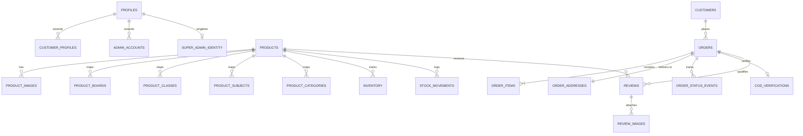

# ProjectBee – Database Schema Specification
## Unified PostgreSQL / Supabase Schema Blueprint

**Version:** 1.0  
**Status:** Canonical database specification for implementation  
**Product:** ProjectBee — *School Projects Made Easy!*  
**Database:** PostgreSQL 15+ (Supabase)  
**Extensions Required:** `uuid-ossp`, `pg_trgm`, `citext`  
**Timezone:** UTC storage (`timestamptz`), presented in `Asia/Kolkata`  
**Monetary Standard:** Integer in Paise (₹1.00 = 100 paise) to prevent floating-point rounding errors  

---

## 1. Overview & Architectural Principles

This document specifies the exact database blueprint for the unified ProjectBee platform, serving the **Customer E-Commerce Website**, the **Admin Dashboard**, and the **Super Admin Control Center**.

### Key Rules
1. **Single Source of Truth:** All 3 applications interact with this single PostgreSQL database with Supabase Row Level Security (RLS).
2. **Immutable Identity:** The auth user ID from Supabase Auth (`auth.users.id`) serves as the root foreign key for all customer, admin, and super admin profiles.
3. **Auditability & Ledgers:** Financial snapshots, order items, stock adjustments, and administrative actions are immutable ledgers.
4. **Child Privacy & DPDP Compliance:** Children's personal information is minimized, separated from public reviews, and strictly access-controlled.
5. **No Fake Capability:** Database enums and status machines reflect real operational states.



---

## 2. Extensions & Shared Utility Functions

```sql
-- Required PostgreSQL extensions
CREATE EXTENSION IF NOT EXISTS "uuid-ossp";
CREATE EXTENSION IF NOT EXISTS "pg_trgm";
CREATE EXTENSION IF NOT EXISTS "citext";

-- Shared automatic updated_at trigger function
CREATE OR REPLACE FUNCTION set_updated_at()
RETURNS TRIGGER AS $$
BEGIN
  NEW.updated_at = NOW();
  RETURN NEW;
END;
$$ LANGUAGE plpgsql;
```

---

## 3. Identity, Roles & Access Control (RBAC)

### 3.1 `profiles`
Central user profile linked to Supabase Auth (`auth.users`).

```sql
CREATE TYPE user_type_enum AS ENUM ('customer', 'admin', 'super_admin');
CREATE TYPE account_status_enum AS ENUM ('active', 'suspended', 'deactivated');

CREATE TABLE profiles (
  id UUID PRIMARY KEY REFERENCES auth.users(id) ON DELETE CASCADE,
  user_type user_type_enum NOT NULL DEFAULT 'customer',
  account_status account_status_enum NOT NULL DEFAULT 'active',
  email CITEXT UNIQUE,
  phone VARCHAR(20) UNIQUE,
  display_name VARCHAR(100),
  avatar_url TEXT,
  last_sign_in_at TIMESTAMPTZ,
  created_at TIMESTAMPTZ NOT NULL DEFAULT NOW(),
  updated_at TIMESTAMPTZ NOT NULL DEFAULT NOW()
);

CREATE TRIGGER trg_profiles_updated_at
BEFORE UPDATE ON profiles
FOR EACH ROW EXECUTE FUNCTION set_updated_at();

CREATE INDEX idx_profiles_email ON profiles(email);
CREATE INDEX idx_profiles_user_type ON profiles(user_type);
```

### 3.2 `customer_profiles`
Optional, progressive student/parent profile details.

```sql
CREATE TYPE academic_group_enum AS ENUM (
  'early_learners',    -- Classes 1-2
  'primary',           -- Classes 3-5
  'middle_school',     -- Classes 6-8
  'secondary',         -- Classes 9-10
  'senior_secondary'   -- Classes 11-12
);

CREATE TABLE customer_profiles (
  profile_id UUID PRIMARY KEY REFERENCES profiles(id) ON DELETE CASCADE,
  parent_name VARCHAR(120),
  student_name VARCHAR(120),
  grade_class INT CHECK (grade_class BETWEEN 1 AND 12),
  board VARCHAR(50), -- CBSE, ICSE, Karnataka State Board
  academic_group academic_group_enum,
  school_name VARCHAR(200),
  favourite_subjects TEXT[],
  city VARCHAR(100),
  state VARCHAR(100),
  profile_completed_at TIMESTAMPTZ,
  created_at TIMESTAMPTZ NOT NULL DEFAULT NOW(),
  updated_at TIMESTAMPTZ NOT NULL DEFAULT NOW()
);

CREATE TRIGGER trg_customer_profiles_updated_at
BEFORE UPDATE ON customer_profiles
FOR EACH ROW EXECUTE FUNCTION set_updated_at();
```

### 3.3 `admin_accounts` & `super_admin_identity`
Administrative identity tracking. Super Admin is strictly singleton.

```sql
CREATE TABLE admin_accounts (
  id UUID PRIMARY KEY DEFAULT uuid_generate_v4(),
  profile_id UUID NOT NULL UNIQUE REFERENCES profiles(id) ON DELETE CASCADE,
  job_title VARCHAR(100),
  invited_by UUID REFERENCES profiles(id),
  invited_at TIMESTAMPTZ NOT NULL DEFAULT NOW(),
  activated_at TIMESTAMPTZ,
  suspended_at TIMESTAMPTZ,
  suspension_reason TEXT,
  created_at TIMESTAMPTZ NOT NULL DEFAULT NOW(),
  updated_at TIMESTAMPTZ NOT NULL DEFAULT NOW()
);

CREATE TRIGGER trg_admin_accounts_updated_at
BEFORE UPDATE ON admin_accounts
FOR EACH ROW EXECUTE FUNCTION set_updated_at();

-- Super Admin Singleton Record (Enforces exactly 1 super admin identity)
CREATE TABLE super_admin_identity (
  id INT PRIMARY KEY CHECK (id = 1), -- Singleton lock
  profile_id UUID NOT NULL UNIQUE REFERENCES profiles(id) ON DELETE RESTRICT,
  designated_at TIMESTAMPTZ NOT NULL DEFAULT NOW(),
  recovery_email CITEXT NOT NULL,
  notes TEXT
);
```

### 3.4 `admin_invitations`
Single-use, time-bound invitation tokens.

```sql
CREATE TYPE invitation_status_enum AS ENUM ('pending', 'accepted', 'revoked', 'expired');

CREATE TABLE admin_invitations (
  id UUID PRIMARY KEY DEFAULT uuid_generate_v4(),
  email CITEXT NOT NULL,
  invited_name VARCHAR(120) NOT NULL,
  token_hash VARCHAR(128) NOT NULL UNIQUE,
  initial_role_id UUID,
  status invitation_status_enum NOT NULL DEFAULT 'pending',
  invited_by UUID NOT NULL REFERENCES profiles(id),
  expires_at TIMESTAMPTZ NOT NULL,
  accepted_at TIMESTAMPTZ,
  revoked_at TIMESTAMPTZ,
  created_at TIMESTAMPTZ NOT NULL DEFAULT NOW()
);

CREATE INDEX idx_admin_invitations_token ON admin_invitations(token_hash);
CREATE INDEX idx_admin_invitations_email ON admin_invitations(email);
```

### 3.5 RBAC: `roles`, `permissions`, `role_permissions`, `admin_role_assignments`, `admin_permission_overrides`

```sql
CREATE TABLE permissions (
  id VARCHAR(60) PRIMARY KEY, -- e.g. 'products.create', 'orders.update_status'
  module VARCHAR(40) NOT NULL,
  description TEXT NOT NULL,
  created_at TIMESTAMPTZ NOT NULL DEFAULT NOW()
);

CREATE TABLE roles (
  id UUID PRIMARY KEY DEFAULT uuid_generate_v4(),
  name VARCHAR(50) UNIQUE NOT NULL, -- e.g. 'Operations Manager', 'Support Staff'
  description TEXT,
  is_system BOOLEAN NOT NULL DEFAULT FALSE, -- Predefined roles cannot be deleted
  created_at TIMESTAMPTZ NOT NULL DEFAULT NOW(),
  updated_at TIMESTAMPTZ NOT NULL DEFAULT NOW()
);

CREATE TABLE role_permissions (
  role_id UUID NOT NULL REFERENCES roles(id) ON DELETE CASCADE,
  permission_id VARCHAR(60) NOT NULL REFERENCES permissions(id) ON DELETE CASCADE,
  PRIMARY KEY (role_id, permission_id)
);

CREATE TABLE admin_role_assignments (
  admin_id UUID NOT NULL REFERENCES admin_accounts(id) ON DELETE CASCADE,
  role_id UUID NOT NULL REFERENCES roles(id) ON DELETE CASCADE,
  assigned_by UUID REFERENCES profiles(id),
  assigned_at TIMESTAMPTZ NOT NULL DEFAULT NOW(),
  PRIMARY KEY (admin_id, role_id)
);

-- Individual allow/deny overrides with precedence: EXPLICIT DENY > EXPLICIT ALLOW > ROLE GRANT > DEFAULT DENY
CREATE TABLE admin_permission_overrides (
  admin_id UUID NOT NULL REFERENCES admin_accounts(id) ON DELETE CASCADE,
  permission_id VARCHAR(60) NOT NULL REFERENCES permissions(id) ON DELETE CASCADE,
  is_allowed BOOLEAN NOT NULL, -- FALSE = explicit deny, TRUE = explicit allow
  granted_by UUID REFERENCES profiles(id),
  granted_at TIMESTAMPTZ NOT NULL DEFAULT NOW(),
  PRIMARY KEY (admin_id, permission_id)
);
```

---

## 4. Academic Taxonomy & Catalogue

### 4.1 Taxonomy Lookups

```sql
CREATE TABLE boards (
  code VARCHAR(20) PRIMARY KEY, -- 'CBSE', 'ICSE', 'STATE_KA', etc.
  name VARCHAR(100) NOT NULL,
  display_order INT NOT NULL DEFAULT 0,
  is_active BOOLEAN NOT NULL DEFAULT TRUE
);

CREATE TABLE classes (
  grade INT PRIMARY KEY CHECK (grade BETWEEN 1 AND 12),
  name VARCHAR(20) NOT NULL, -- 'Class 1', 'Class 10'
  academic_group academic_group_enum NOT NULL,
  display_order INT NOT NULL DEFAULT 0,
  is_active BOOLEAN NOT NULL DEFAULT TRUE
);

CREATE TABLE subjects (
  id UUID PRIMARY KEY DEFAULT uuid_generate_v4(),
  slug VARCHAR(60) UNIQUE NOT NULL,
  name VARCHAR(100) NOT NULL,
  code VARCHAR(30),
  icon_url TEXT,
  display_order INT NOT NULL DEFAULT 0,
  is_active BOOLEAN NOT NULL DEFAULT TRUE
);

CREATE TABLE categories (
  id UUID PRIMARY KEY DEFAULT uuid_generate_v4(),
  parent_id UUID REFERENCES categories(id) ON DELETE SET NULL,
  slug VARCHAR(80) UNIQUE NOT NULL,
  name VARCHAR(100) NOT NULL,
  description TEXT,
  image_url TEXT,
  display_order INT NOT NULL DEFAULT 0,
  is_active BOOLEAN NOT NULL DEFAULT TRUE,
  created_at TIMESTAMPTZ NOT NULL DEFAULT NOW(),
  updated_at TIMESTAMPTZ NOT NULL DEFAULT NOW()
);

CREATE TABLE product_formats (
  id VARCHAR(40) PRIMARY KEY, -- 'working_model', 'diy_kit', 'science_fair_display', 'chart_and_viva'
  name VARCHAR(100) NOT NULL,
  description TEXT,
  display_order INT NOT NULL DEFAULT 0
);
```

### 4.2 `products` & Relations

```sql
CREATE TYPE product_status_enum AS ENUM ('draft', 'published', 'unpublished', 'archived', 'deleted');
CREATE TYPE difficulty_level_enum AS ENUM ('beginner', 'intermediate', 'advanced');

CREATE TABLE products (
  id UUID PRIMARY KEY DEFAULT uuid_generate_v4(),
  sku VARCHAR(50) UNIQUE NOT NULL,
  slug VARCHAR(120) UNIQUE NOT NULL,
  title VARCHAR(200) NOT NULL,
  short_description TEXT NOT NULL,
  full_description TEXT NOT NULL,
  package_contents TEXT NOT NULL,
  preparation_guide TEXT,
  safety_notes TEXT,
  dimensions_cm VARCHAR(50),
  weight_grams INT,
  format_id VARCHAR(40) NOT NULL REFERENCES product_formats(id),
  difficulty difficulty_level_enum NOT NULL DEFAULT 'beginner',
  status product_status_enum NOT NULL DEFAULT 'draft',
  
  -- Price stored in paise (1 INR = 100 paise)
  mrp_paise INT NOT NULL CHECK (mrp_paise >= 0),
  selling_price_paise INT NOT NULL CHECK (selling_price_paise >= 0 AND selling_price_paise <= mrp_paise),
  cost_price_paise INT CHECK (cost_price_paise >= 0),
  tax_rate_percent NUMERIC(5,2) NOT NULL DEFAULT 18.00,
  
  -- Ratings cache (recalculated atomically upon review approval)
  rating_avg NUMERIC(3,2) NOT NULL DEFAULT 0.00,
  rating_count INT NOT NULL DEFAULT 0,
  
  is_featured BOOLEAN NOT NULL DEFAULT FALSE,
  is_popular BOOLEAN NOT NULL DEFAULT FALSE,
  requires_assembly BOOLEAN NOT NULL DEFAULT FALSE,
  estimated_assembly_time_mins INT,
  
  meta_title VARCHAR(150),
  meta_description VARCHAR(250),
  
  published_at TIMESTAMPTZ,
  created_at TIMESTAMPTZ NOT NULL DEFAULT NOW(),
  updated_at TIMESTAMPTZ NOT NULL DEFAULT NOW()
);

CREATE TRIGGER trg_products_updated_at
BEFORE UPDATE ON products
FOR EACH ROW EXECUTE FUNCTION set_updated_at();

-- Full text search and trigram index
ALTER TABLE products ADD COLUMN fts_document tsvector 
  GENERATED ALWAYS AS (
    setweight(to_tsvector('english', coalesce(title, '')), 'A') ||
    setweight(to_tsvector('english', coalesce(short_description, '')), 'B') ||
    setweight(to_tsvector('english', coalesce(full_description, '')), 'C')
  ) STORED;

CREATE INDEX idx_products_fts ON products USING GIN(fts_document);
CREATE INDEX idx_products_title_trgm ON products USING GIN(title gin_trgm_ops);
CREATE INDEX idx_products_sku ON products(sku);
CREATE INDEX idx_products_status_published ON products(status, published_at);
```

### 4.3 Product Images & Mappings

```sql
CREATE TABLE product_images (
  id UUID PRIMARY KEY DEFAULT uuid_generate_v4(),
  product_id UUID NOT NULL REFERENCES products(id) ON DELETE CASCADE,
  storage_key TEXT NOT NULL,
  alt_text VARCHAR(200) NOT NULL,
  is_primary BOOLEAN NOT NULL DEFAULT FALSE,
  display_order INT NOT NULL DEFAULT 0,
  created_at TIMESTAMPTZ NOT NULL DEFAULT NOW()
);

CREATE INDEX idx_product_images_product ON product_images(product_id, display_order);

-- Many-to-Many Mappings for Multidisciplinary Academic Taxonomy
CREATE TABLE product_boards (
  product_id UUID NOT NULL REFERENCES products(id) ON DELETE CASCADE,
  board_code VARCHAR(20) NOT NULL REFERENCES boards(code) ON DELETE CASCADE,
  PRIMARY KEY (product_id, board_code)
);

CREATE TABLE product_classes (
  product_id UUID NOT NULL REFERENCES products(id) ON DELETE CASCADE,
  grade INT NOT NULL REFERENCES classes(grade) ON DELETE CASCADE,
  PRIMARY KEY (product_id, grade)
);

CREATE TABLE product_subjects (
  product_id UUID NOT NULL REFERENCES products(id) ON DELETE CASCADE,
  subject_id UUID NOT NULL REFERENCES subjects(id) ON DELETE CASCADE,
  PRIMARY KEY (product_id, subject_id)
);

CREATE TABLE product_categories (
  product_id UUID NOT NULL REFERENCES products(id) ON DELETE CASCADE,
  category_id UUID NOT NULL REFERENCES categories(id) ON DELETE CASCADE,
  is_primary BOOLEAN NOT NULL DEFAULT FALSE,
  PRIMARY KEY (product_id, category_id)
);

-- External Video Demonstrations & Social Media (No large videos rehosted)
CREATE TYPE social_platform_enum AS ENUM ('youtube_video', 'youtube_shorts', 'instagram_reel', 'facebook_video');

CREATE TABLE product_social_links (
  id UUID PRIMARY KEY DEFAULT uuid_generate_v4(),
  product_id UUID NOT NULL REFERENCES products(id) ON DELETE CASCADE,
  platform social_platform_enum NOT NULL,
  video_url TEXT NOT NULL,
  embed_code TEXT,
  title VARCHAR(200),
  display_order INT NOT NULL DEFAULT 0,
  is_active BOOLEAN NOT NULL DEFAULT TRUE,
  created_at TIMESTAMPTZ NOT NULL DEFAULT NOW()
);

-- Managed Search Synonyms & Keywords
CREATE TABLE product_keywords (
  product_id UUID NOT NULL REFERENCES products(id) ON DELETE CASCADE,
  keyword VARCHAR(80) NOT NULL,
  PRIMARY KEY (product_id, keyword)
);

CREATE TABLE search_synonyms (
  id UUID PRIMARY KEY DEFAULT uuid_generate_v4(),
  term VARCHAR(80) NOT NULL,
  synonyms TEXT[] NOT NULL,
  is_active BOOLEAN NOT NULL DEFAULT TRUE
);
```

---

## 5. Inventory & Stock Ledger

```sql
CREATE TABLE inventory (
  product_id UUID PRIMARY KEY REFERENCES products(id) ON DELETE CASCADE,
  stock_on_hand INT NOT NULL DEFAULT 0 CHECK (stock_on_hand >= 0),
  stock_reserved INT NOT NULL DEFAULT 0 CHECK (stock_reserved >= 0),
  -- stock_available generated virtual/stored: stock_on_hand - stock_reserved
  low_stock_threshold INT NOT NULL DEFAULT 5,
  is_backorder_allowed BOOLEAN NOT NULL DEFAULT FALSE,
  updated_at TIMESTAMPTZ NOT NULL DEFAULT NOW()
);

CREATE TYPE stock_movement_type_enum AS ENUM (
  'initial_intake',
  'order_reservation',
  'order_cancelled_release',
  'order_fulfilled',
  'return_restocked',
  'damage_writeoff',
  'manual_adjustment'
);

-- Immutable Ledger of every physical stock variation
CREATE TABLE stock_movements (
  id UUID PRIMARY KEY DEFAULT uuid_generate_v4(),
  product_id UUID NOT NULL REFERENCES products(id) ON DELETE CASCADE,
  movement_type stock_movement_type_enum NOT NULL,
  quantity_delta INT NOT NULL, -- Positive for intake/return, negative for fulfillment/damage
  resulting_stock_on_hand INT NOT NULL,
  reference_order_id UUID,
  reference_adjustment_id UUID,
  notes TEXT,
  created_by UUID REFERENCES profiles(id),
  created_at TIMESTAMPTZ NOT NULL DEFAULT NOW()
);

CREATE TABLE inventory_adjustments (
  id UUID PRIMARY KEY DEFAULT uuid_generate_v4(),
  product_id UUID NOT NULL REFERENCES products(id) ON DELETE CASCADE,
  previous_stock INT NOT NULL,
  new_stock INT NOT NULL,
  delta INT NOT NULL,
  reason VARCHAR(255) NOT NULL,
  adjusted_by UUID NOT NULL REFERENCES profiles(id),
  created_at TIMESTAMPTZ NOT NULL DEFAULT NOW()
);

CREATE TABLE price_history (
  id UUID PRIMARY KEY DEFAULT uuid_generate_v4(),
  product_id UUID NOT NULL REFERENCES products(id) ON DELETE CASCADE,
  old_mrp_paise INT NOT NULL,
  new_mrp_paise INT NOT NULL,
  old_selling_price_paise INT NOT NULL,
  new_selling_price_paise INT NOT NULL,
  changed_by UUID NOT NULL REFERENCES profiles(id),
  effective_from TIMESTAMPTZ NOT NULL DEFAULT NOW()
);
```

---

## 6. Cart & Order Processing (V1 COD Focus)

### 6.1 `carts` & `cart_items`

```sql
CREATE TABLE carts (
  id UUID PRIMARY KEY DEFAULT uuid_generate_v4(),
  customer_id UUID REFERENCES profiles(id) ON DELETE CASCADE,
  guest_session_token VARCHAR(128) UNIQUE,
  created_at TIMESTAMPTZ NOT NULL DEFAULT NOW(),
  updated_at TIMESTAMPTZ NOT NULL DEFAULT NOW()
);

CREATE TABLE cart_items (
  id UUID PRIMARY KEY DEFAULT uuid_generate_v4(),
  cart_id UUID NOT NULL REFERENCES carts(id) ON DELETE CASCADE,
  product_id UUID NOT NULL REFERENCES products(id) ON DELETE CASCADE,
  quantity INT NOT NULL DEFAULT 1 CHECK (quantity > 0 AND quantity <= 10),
  created_at TIMESTAMPTZ NOT NULL DEFAULT NOW(),
  updated_at TIMESTAMPTZ NOT NULL DEFAULT NOW(),
  UNIQUE (cart_id, product_id)
);
```

### 6.2 `orders`, `order_items`, `order_addresses`

```sql
CREATE TYPE order_status_enum AS ENUM (
  'pending_verification',  -- Awaiting WhatsApp COD OTP verification
  'confirmed',             -- Verified & accepted for processing
  'processing',            -- In procurement/assembly
  'packed',                -- Packaged & box sealed
  'shipped',               -- Handed over to courier (Shiprocket)
  'out_for_delivery',      -- Reached destination delivery hub
  'delivered',             -- Delivered & Cash collected
  'cancelled',             -- Cancelled before shipment
  'return_requested',      -- Return requested by customer
  'returned',              -- Returned to origin & verified
  'failed_delivery'        -- Undelivered / Customer refused COD
);

CREATE TYPE payment_method_enum AS ENUM ('cod'); -- V1 COD only; online payment enums reserved for V2

CREATE TABLE orders (
  id UUID PRIMARY KEY DEFAULT uuid_generate_v4(),
  order_number VARCHAR(30) UNIQUE NOT NULL, -- e.g. 'PB-202611-0012'
  customer_id UUID REFERENCES profiles(id) ON DELETE RESTRICT,
  status order_status_enum NOT NULL DEFAULT 'pending_verification',
  payment_method payment_method_enum NOT NULL DEFAULT 'cod',
  
  -- Calculated amounts in paise
  subtotal_paise INT NOT NULL CHECK (subtotal_paise >= 0),
  discount_paise INT NOT NULL DEFAULT 0 CHECK (discount_paise >= 0),
  shipping_fee_paise INT NOT NULL DEFAULT 0 CHECK (shipping_fee_paise >= 0),
  tax_paise INT NOT NULL DEFAULT 0 CHECK (tax_paise >= 0),
  total_payable_paise INT NOT NULL CHECK (total_payable_paise >= 0),
  
  coupon_code VARCHAR(30),
  parent_name VARCHAR(120) NOT NULL,
  parent_phone VARCHAR(20) NOT NULL,
  parent_whatsapp VARCHAR(20) NOT NULL,
  student_name VARCHAR(120),
  student_class INT,
  
  verified_at TIMESTAMPTZ,
  confirmed_at TIMESTAMPTZ,
  shipped_at TIMESTAMPTZ,
  delivered_at TIMESTAMPTZ,
  cancelled_at TIMESTAMPTZ,
  cancellation_reason TEXT,
  
  created_at TIMESTAMPTZ NOT NULL DEFAULT NOW(),
  updated_at TIMESTAMPTZ NOT NULL DEFAULT NOW()
);

CREATE TRIGGER trg_orders_updated_at
BEFORE UPDATE ON orders
FOR EACH ROW EXECUTE FUNCTION set_updated_at();

CREATE INDEX idx_orders_customer ON orders(customer_id);
CREATE INDEX idx_orders_status ON orders(status);
CREATE INDEX idx_orders_number ON orders(order_number);

-- Immutable Purchase-Time Snapshot
CREATE TABLE order_items (
  id UUID PRIMARY KEY DEFAULT uuid_generate_v4(),
  order_id UUID NOT NULL REFERENCES orders(id) ON DELETE CASCADE,
  product_id UUID NOT NULL REFERENCES products(id) ON DELETE RESTRICT,
  title_snapshot VARCHAR(200) NOT NULL,
  sku_snapshot VARCHAR(50) NOT NULL,
  unit_price_paise INT NOT NULL CHECK (unit_price_paise >= 0),
  quantity INT NOT NULL CHECK (quantity > 0),
  total_paise INT NOT NULL CHECK (total_paise >= 0),
  tax_rate_percent NUMERIC(5,2) NOT NULL DEFAULT 18.00,
  tax_amount_paise INT NOT NULL DEFAULT 0,
  created_at TIMESTAMPTZ NOT NULL DEFAULT NOW()
);

CREATE TABLE order_addresses (
  order_id UUID PRIMARY KEY REFERENCES orders(id) ON DELETE CASCADE,
  recipient_name VARCHAR(120) NOT NULL,
  phone VARCHAR(20) NOT NULL,
  alternate_phone VARCHAR(20),
  address_line1 VARCHAR(255) NOT NULL,
  address_line2 VARCHAR(255),
  landmark VARCHAR(150),
  city VARCHAR(100) NOT NULL,
  state VARCHAR(100) NOT NULL,
  pincode VARCHAR(10) NOT NULL,
  delivery_instructions TEXT
);

-- Timeline of status changes
CREATE TABLE order_status_events (
  id UUID PRIMARY KEY DEFAULT uuid_generate_v4(),
  order_id UUID NOT NULL REFERENCES orders(id) ON DELETE CASCADE,
  from_status order_status_enum,
  to_status order_status_enum NOT NULL,
  actor_id UUID REFERENCES profiles(id),
  actor_type VARCHAR(30) NOT NULL, -- 'system', 'customer', 'admin', 'super_admin'
  notes TEXT,
  created_at TIMESTAMPTZ NOT NULL DEFAULT NOW()
);
```

### 6.3 `cod_verifications` (WhatsApp OTP)

```sql
CREATE TYPE otp_status_enum AS ENUM ('sent', 'verified', 'failed', 'expired');

CREATE TABLE cod_verifications (
  id UUID PRIMARY KEY DEFAULT uuid_generate_v4(),
  order_id UUID NOT NULL UNIQUE REFERENCES orders(id) ON DELETE CASCADE,
  phone VARCHAR(20) NOT NULL,
  -- Plaintext OTP is NEVER stored. Store SHA-256 hash with salt.
  otp_hash VARCHAR(128) NOT NULL,
  status otp_status_enum NOT NULL DEFAULT 'sent',
  attempt_count INT NOT NULL DEFAULT 0 CHECK (attempt_count <= 5),
  provider_message_id VARCHAR(100),
  provider_response JSONB,
  expires_at TIMESTAMPTZ NOT NULL,
  verified_at TIMESTAMPTZ,
  created_at TIMESTAMPTZ NOT NULL DEFAULT NOW()
);
```

### 6.4 `cancellations`, `returns`, `cod_reconciliations`

```sql
CREATE TABLE cancellations (
  id UUID PRIMARY KEY DEFAULT uuid_generate_v4(),
  order_id UUID NOT NULL UNIQUE REFERENCES orders(id) ON DELETE RESTRICT,
  cancelled_by UUID REFERENCES profiles(id),
  initiator_type VARCHAR(20) NOT NULL, -- 'customer', 'admin'
  reason_code VARCHAR(50) NOT NULL,
  detailed_reason TEXT,
  created_at TIMESTAMPTZ NOT NULL DEFAULT NOW()
);

CREATE TABLE returns (
  id UUID PRIMARY KEY DEFAULT uuid_generate_v4(),
  order_id UUID NOT NULL REFERENCES orders(id) ON DELETE RESTRICT,
  reason VARCHAR(255) NOT NULL,
  customer_comments TEXT,
  status VARCHAR(40) NOT NULL DEFAULT 'requested',
  inspection_notes TEXT,
  received_at TIMESTAMPTZ,
  approved_by UUID REFERENCES profiles(id),
  created_at TIMESTAMPTZ NOT NULL DEFAULT NOW()
);

CREATE TABLE cod_reconciliations (
  id UUID PRIMARY KEY DEFAULT uuid_generate_v4(),
  order_id UUID NOT NULL UNIQUE REFERENCES orders(id) ON DELETE RESTRICT,
  courier_partner VARCHAR(50) NOT NULL,
  collected_amount_paise INT NOT NULL,
  courier_remittance_id VARCHAR(100),
  remitted_at TIMESTAMPTZ,
  is_reconciled BOOLEAN NOT NULL DEFAULT FALSE,
  reconciled_by UUID REFERENCES profiles(id),
  reconciled_at TIMESTAMPTZ
);
```

---

## 7. Logistics & Serviceability

```sql
CREATE TABLE serviceable_pincodes (
  pincode VARCHAR(10) PRIMARY KEY,
  city VARCHAR(100) NOT NULL,
  state VARCHAR(100) NOT NULL,
  is_cod_allowed BOOLEAN NOT NULL DEFAULT TRUE,
  min_delivery_days INT NOT NULL DEFAULT 3,
  max_delivery_days INT NOT NULL DEFAULT 7,
  is_active BOOLEAN NOT NULL DEFAULT TRUE,
  created_at TIMESTAMPTZ NOT NULL DEFAULT NOW(),
  updated_at TIMESTAMPTZ NOT NULL DEFAULT NOW()
);

CREATE TABLE shipping_rules (
  id UUID PRIMARY KEY DEFAULT uuid_generate_v4(),
  name VARCHAR(100) NOT NULL,
  min_order_paise INT NOT NULL DEFAULT 0,
  max_order_paise INT,
  shipping_fee_paise INT NOT NULL DEFAULT 7000, -- ₹70 flat fee standard
  is_active BOOLEAN NOT NULL DEFAULT TRUE,
  created_at TIMESTAMPTZ NOT NULL DEFAULT NOW()
);

CREATE TABLE shipments (
  id UUID PRIMARY KEY DEFAULT uuid_generate_v4(),
  order_id UUID NOT NULL REFERENCES orders(id) ON DELETE RESTRICT,
  courier_name VARCHAR(50) NOT NULL, -- 'Shiprocket', 'Delhivery', etc.
  awb_number VARCHAR(80) NOT NULL UNIQUE,
  label_url TEXT,
  manifest_id VARCHAR(80),
  tracking_status VARCHAR(60),
  estimated_delivery_date DATE,
  dispatched_at TIMESTAMPTZ,
  delivered_at TIMESTAMPTZ,
  created_at TIMESTAMPTZ NOT NULL DEFAULT NOW()
);

CREATE TABLE shipment_events (
  id UUID PRIMARY KEY DEFAULT uuid_generate_v4(),
  shipment_id UUID NOT NULL REFERENCES shipments(id) ON DELETE CASCADE,
  checkpoint_time TIMESTAMPTZ NOT NULL,
  location VARCHAR(120),
  status VARCHAR(60) NOT NULL,
  message TEXT,
  created_at TIMESTAMPTZ NOT NULL DEFAULT NOW()
);
```

---

## 8. Customer Engagement & Verified Reviews

### 8.1 Verified-Purchase Reviews

```sql
CREATE TYPE review_status_enum AS ENUM ('pending', 'approved', 'rejected');

CREATE TABLE reviews (
  id UUID PRIMARY KEY DEFAULT uuid_generate_v4(),
  product_id UUID NOT NULL REFERENCES products(id) ON DELETE CASCADE,
  customer_id UUID NOT NULL REFERENCES profiles(id) ON DELETE CASCADE,
  order_id UUID NOT NULL REFERENCES orders(id) ON DELETE RESTRICT,
  order_item_id UUID NOT NULL REFERENCES order_items(id) ON DELETE RESTRICT,
  
  rating INT NOT NULL CHECK (rating BETWEEN 1 AND 5),
  title VARCHAR(150),
  review_text TEXT NOT NULL,
  
  -- Privacy-Preserving Display Name (e.g., 'Ananya S., Class 7 Parent')
  reviewer_display_name VARCHAR(100) NOT NULL,
  
  is_verified_purchase BOOLEAN NOT NULL DEFAULT TRUE,
  status review_status_enum NOT NULL DEFAULT 'approved',
  moderated_by UUID REFERENCES profiles(id),
  moderation_notes TEXT,
  helpful_votes_count INT NOT NULL DEFAULT 0,
  
  created_at TIMESTAMPTZ NOT NULL DEFAULT NOW(),
  updated_at TIMESTAMPTZ NOT NULL DEFAULT NOW(),
  
  -- Strictly 1 review per product per verified order
  UNIQUE (product_id, customer_id, order_id)
);

CREATE TABLE review_images (
  id UUID PRIMARY KEY DEFAULT uuid_generate_v4(),
  review_id UUID NOT NULL REFERENCES reviews(id) ON DELETE CASCADE,
  storage_key TEXT NOT NULL,
  moderation_status VARCHAR(30) NOT NULL DEFAULT 'pending',
  moderated_by UUID REFERENCES profiles(id),
  created_at TIMESTAMPTZ NOT NULL DEFAULT NOW()
);

CREATE TABLE review_helpful_votes (
  review_id UUID NOT NULL REFERENCES reviews(id) ON DELETE CASCADE,
  voter_id UUID NOT NULL REFERENCES profiles(id) ON DELETE CASCADE,
  created_at TIMESTAMPTZ NOT NULL DEFAULT NOW(),
  PRIMARY KEY (review_id, voter_id)
);

CREATE TABLE review_reports (
  id UUID PRIMARY KEY DEFAULT uuid_generate_v4(),
  review_id UUID NOT NULL REFERENCES reviews(id) ON DELETE CASCADE,
  reporter_id UUID REFERENCES profiles(id),
  reason VARCHAR(100) NOT NULL,
  details TEXT,
  status VARCHAR(30) NOT NULL DEFAULT 'open',
  resolved_by UUID REFERENCES profiles(id),
  resolved_at TIMESTAMPTZ,
  created_at TIMESTAMPTZ NOT NULL DEFAULT NOW()
);
```

### 8.2 Wishlist, Customer Addresses & DPDP Compliance

```sql
CREATE TABLE wishlists (
  id UUID PRIMARY KEY DEFAULT uuid_generate_v4(),
  customer_id UUID NOT NULL UNIQUE REFERENCES profiles(id) ON DELETE CASCADE,
  created_at TIMESTAMPTZ NOT NULL DEFAULT NOW()
);

CREATE TABLE wishlist_items (
  wishlist_id UUID NOT NULL REFERENCES wishlists(id) ON DELETE CASCADE,
  product_id UUID NOT NULL REFERENCES products(id) ON DELETE CASCADE,
  created_at TIMESTAMPTZ NOT NULL DEFAULT NOW(),
  PRIMARY KEY (wishlist_id, product_id)
);

CREATE TABLE customer_addresses (
  id UUID PRIMARY KEY DEFAULT uuid_generate_v4(),
  customer_id UUID NOT NULL REFERENCES profiles(id) ON DELETE CASCADE,
  recipient_name VARCHAR(120) NOT NULL,
  phone VARCHAR(20) NOT NULL,
  address_line1 VARCHAR(255) NOT NULL,
  address_line2 VARCHAR(255),
  city VARCHAR(100) NOT NULL,
  state VARCHAR(100) NOT NULL,
  pincode VARCHAR(10) NOT NULL,
  is_default BOOLEAN NOT NULL DEFAULT FALSE,
  created_at TIMESTAMPTZ NOT NULL DEFAULT NOW()
);

-- DPDP (Digital Personal Data Protection) Requests
CREATE TABLE customer_data_requests (
  id UUID PRIMARY KEY DEFAULT uuid_generate_v4(),
  customer_id UUID NOT NULL REFERENCES profiles(id) ON DELETE CASCADE,
  request_type VARCHAR(40) NOT NULL, -- 'data_export', 'data_correction', 'account_deletion'
  status VARCHAR(30) NOT NULL DEFAULT 'submitted',
  processed_by UUID REFERENCES profiles(id),
  completion_notes TEXT,
  submitted_at TIMESTAMPTZ NOT NULL DEFAULT NOW(),
  completed_at TIMESTAMPTZ
);
```

---

## 9. Content, Coupons & Storefront Promotions

```sql
CREATE TABLE banners (
  id UUID PRIMARY KEY DEFAULT uuid_generate_v4(),
  title VARCHAR(120) NOT NULL,
  desktop_image_url TEXT NOT NULL,
  mobile_image_url TEXT NOT NULL,
  link_url TEXT,
  target_board VARCHAR(20),
  target_class INT,
  display_order INT NOT NULL DEFAULT 0,
  is_active BOOLEAN NOT NULL DEFAULT TRUE,
  starts_at TIMESTAMPTZ,
  ends_at TIMESTAMPTZ,
  created_at TIMESTAMPTZ NOT NULL DEFAULT NOW()
);

CREATE TABLE coupons (
  code VARCHAR(30) PRIMARY KEY,
  description VARCHAR(200),
  discount_type VARCHAR(20) NOT NULL, -- 'percentage', 'flat'
  discount_value INT NOT NULL, -- Percentage (e.g. 10) or Flat Paise (e.g. 10000 = ₹100)
  min_order_paise INT NOT NULL DEFAULT 0,
  max_discount_paise INT,
  usage_limit_total INT,
  usage_limit_per_customer INT NOT NULL DEFAULT 1,
  times_used INT NOT NULL DEFAULT 0,
  is_active BOOLEAN NOT NULL DEFAULT TRUE,
  valid_from TIMESTAMPTZ NOT NULL DEFAULT NOW(),
  valid_until TIMESTAMPTZ,
  created_at TIMESTAMPTZ NOT NULL DEFAULT NOW()
);

CREATE TABLE content_pages (
  slug VARCHAR(100) PRIMARY KEY,
  title VARCHAR(150) NOT NULL,
  body_markdown TEXT NOT NULL,
  is_published BOOLEAN NOT NULL DEFAULT TRUE,
  updated_by UUID REFERENCES profiles(id),
  updated_at TIMESTAMPTZ NOT NULL DEFAULT NOW()
);

CREATE TABLE faqs (
  id UUID PRIMARY KEY DEFAULT uuid_generate_v4(),
  category VARCHAR(60) NOT NULL,
  question TEXT NOT NULL,
  answer TEXT NOT NULL,
  display_order INT NOT NULL DEFAULT 0,
  is_active BOOLEAN NOT NULL DEFAULT TRUE
);
```

---

## 10. System, Configuration & Audit Ledgers

```sql
-- Dynamic, non-secret system settings (Key-Value)
CREATE TABLE global_settings (
  key VARCHAR(80) PRIMARY KEY,
  value JSONB NOT NULL,
  value_type VARCHAR(30) NOT NULL, -- 'string', 'number', 'boolean', 'json'
  description TEXT,
  updated_by UUID REFERENCES profiles(id),
  updated_at TIMESTAMPTZ NOT NULL DEFAULT NOW()
);

-- Basic Feature Toggles (ON/OFF)
CREATE TABLE feature_flags (
  key VARCHAR(80) PRIMARY KEY,
  is_enabled BOOLEAN NOT NULL DEFAULT TRUE,
  description TEXT,
  updated_by UUID REFERENCES profiles(id),
  updated_at TIMESTAMPTZ NOT NULL DEFAULT NOW()
);

-- Protected, Append-Only Administrative & Security Audit Trail
CREATE TABLE audit_logs (
  id UUID PRIMARY KEY DEFAULT uuid_generate_v4(),
  actor_id UUID REFERENCES profiles(id),
  actor_role VARCHAR(50),
  module VARCHAR(50) NOT NULL, -- 'catalog', 'orders', 'rbac', 'settings'
  action VARCHAR(80) NOT NULL, -- 'product.publish', 'admin.invite', 'order.status_change'
  target_id VARCHAR(80),
  old_values JSONB,
  new_values JSONB,
  ip_address INET,
  user_agent TEXT,
  created_at TIMESTAMPTZ NOT NULL DEFAULT NOW()
);

CREATE INDEX idx_audit_logs_actor ON audit_logs(actor_id, created_at);
CREATE INDEX idx_audit_logs_module ON audit_logs(module, created_at);

-- In-Dashboard Notification Inbox
CREATE TABLE notifications (
  id UUID PRIMARY KEY DEFAULT uuid_generate_v4(),
  recipient_profile_id UUID NOT NULL REFERENCES profiles(id) ON DELETE CASCADE,
  title VARCHAR(150) NOT NULL,
  message TEXT NOT NULL,
  link_url TEXT,
  is_read BOOLEAN NOT NULL DEFAULT FALSE,
  created_at TIMESTAMPTZ NOT NULL DEFAULT NOW()
);
```

---

## 11. Row Level Security (RLS) Policies

All tables exposed to client APIs have Row Level Security enabled. Privileged operations are mediated via RLS helper functions.

```sql
-- 1. Helper function: Is current user Super Admin?
CREATE OR REPLACE FUNCTION is_super_admin(user_id UUID)
RETURNS BOOLEAN AS $$
BEGIN
  RETURN EXISTS (
    SELECT 1 FROM super_admin_identity
    WHERE profile_id = user_id
  );
END;
$$ LANGUAGE plpgsql SECURITY DEFINER;

-- 2. Helper function: Check if current user has permission (RBAC + Overrides)
CREATE OR REPLACE FUNCTION has_permission(user_id UUID, perm_id VARCHAR)
RETURNS BOOLEAN AS $$
DECLARE
  v_admin_id UUID;
  v_override BOOLEAN;
BEGIN
  -- Super admin has all permissions
  IF is_super_admin(user_id) THEN
    RETURN TRUE;
  END IF;

  SELECT id INTO v_admin_id FROM admin_accounts WHERE profile_id = user_id;
  IF v_admin_id IS NULL THEN
    RETURN FALSE;
  END IF;

  -- 1. Explicit override check (Explicit Deny or Explicit Allow)
  SELECT is_allowed INTO v_override
  FROM admin_permission_overrides
  WHERE admin_id = v_admin_id AND permission_id = perm_id;

  IF v_override IS NOT NULL THEN
    RETURN v_override;
  END IF;

  -- 2. Role grants check
  RETURN EXISTS (
    SELECT 1 
    FROM admin_role_assignments ara
    JOIN role_permissions rp ON ara.role_id = rp.role_id
    WHERE ara.admin_id = v_admin_id AND rp.permission_id = perm_id
  );
END;
$$ LANGUAGE plpgsql SECURITY DEFINER;

-- 3. Enable RLS across application tables
ALTER TABLE profiles ENABLE ROW LEVEL SECURITY;
ALTER TABLE customer_profiles ENABLE ROW LEVEL SECURITY;
ALTER TABLE products ENABLE ROW LEVEL SECURITY;
ALTER TABLE orders ENABLE ROW LEVEL SECURITY;
ALTER TABLE order_items ENABLE ROW LEVEL SECURITY;
ALTER TABLE reviews ENABLE ROW LEVEL SECURITY;
ALTER TABLE wishlists ENABLE ROW LEVEL SECURITY;
ALTER TABLE audit_logs ENABLE ROW LEVEL SECURITY;

-- 4. Sample RLS Policies

-- PROFILES
CREATE POLICY "Public profiles are viewable by everyone"
ON profiles FOR SELECT USING (true);

CREATE POLICY "Users can update own profile"
ON profiles FOR UPDATE USING (auth.uid() = id);

-- PRODUCTS
CREATE POLICY "Anyone can view published products"
ON products FOR SELECT USING (status = 'published');

CREATE POLICY "Admins with product permissions can manage products"
ON products FOR ALL USING (has_permission(auth.uid(), 'products.manage'));

-- ORDERS
CREATE POLICY "Customers can view their own orders"
ON orders FOR SELECT USING (customer_id = auth.uid());

CREATE POLICY "Admins with orders permission can view all orders"
ON orders FOR SELECT USING (has_permission(auth.uid(), 'orders.view'));

-- REVIEWS
CREATE POLICY "Anyone can view approved reviews"
ON reviews FOR SELECT USING (status = 'approved');

CREATE POLICY "Verified purchasers can insert reviews for delivered orders"
ON reviews FOR INSERT WITH CHECK (
  auth.uid() = customer_id AND
  EXISTS (
    SELECT 1 FROM orders 
    WHERE orders.id = reviews.order_id 
      AND orders.customer_id = auth.uid() 
      AND orders.status = 'delivered'
  )
);

-- AUDIT LOGS (Strictly Super Admin / Security Admin view; append-only via trusted server functions)
CREATE POLICY "Super Admins can view audit logs"
ON audit_logs FOR SELECT USING (is_super_admin(auth.uid()));
```

---

## 12. Atomic Operations & Business Logic Procedures

### 12.1 Atomic Stock Reservation Procedure

```sql
CREATE OR REPLACE FUNCTION reserve_order_stock(
  p_order_id UUID,
  p_product_id UUID,
  p_quantity INT,
  p_actor_id UUID
)
RETURNS BOOLEAN AS $$
DECLARE
  v_available INT;
BEGIN
  -- Row-level lock on inventory record
  SELECT (stock_on_hand - stock_reserved) INTO v_available
  FROM inventory
  WHERE product_id = p_product_id
  FOR UPDATE;

  IF v_available < p_quantity THEN
    RAISE EXCEPTION 'Insufficient available stock for product %: requested %, available %', 
      p_product_id, p_quantity, v_available;
  END IF;

  -- Reserve the stock
  UPDATE inventory
  SET stock_reserved = stock_reserved + p_quantity,
      updated_at = NOW()
  WHERE product_id = p_product_id;

  -- Record movement
  INSERT INTO stock_movements (
    product_id, movement_type, quantity_delta, resulting_stock_on_hand,
    reference_order_id, created_by, notes
  ) VALUES (
    p_product_id, 'order_reservation', -p_quantity, v_available - p_quantity,
    p_order_id, p_actor_id, 'Stock reserved for order checkout'
  );

  RETURN TRUE;
END;
$$ LANGUAGE plpgsql SECURITY DEFINER;
```

### 12.2 Product Rating Recalculation Trigger

```sql
CREATE OR REPLACE FUNCTION update_product_rating_cache()
RETURNS TRIGGER AS $$
DECLARE
  v_prod_id UUID;
  v_count INT;
  v_avg NUMERIC(3,2);
BEGIN
  v_prod_id := COALESCE(NEW.product_id, OLD.product_id);

  SELECT COUNT(*), COALESCE(AVG(rating), 0.00)
  INTO v_count, v_avg
  FROM reviews
  WHERE product_id = v_prod_id AND status = 'approved';

  UPDATE products
  SET rating_count = v_count,
      rating_avg = v_avg
  WHERE id = v_prod_id;

  RETURN NULL;
END;
$$ LANGUAGE plpgsql;

CREATE TRIGGER trg_review_rating_cache
AFTER INSERT OR UPDATE OR DELETE ON reviews
FOR EACH ROW EXECUTE FUNCTION update_product_rating_cache();
```

---

## 13. Data Migration & Seeding Sequence

When bootstrapping the Supabase PostgreSQL database:

1. **Phase 1: Extensions & Utilities** (`uuid-ossp`, `pg_trgm`, `citext`, `set_updated_at`).
2. **Phase 2: Academic Lookups** (`boards`, `classes`, `academic_groups`, `subjects`, `product_formats`).
3. **Phase 3: Identity & RBAC** (`profiles`, `roles`, `permissions`, `role_permissions`, `super_admin_identity`).
4. **Phase 4: Catalogue & Media** (`categories`, `products`, `product_images`, taxonomy maps, search indexes).
5. **Phase 5: Inventory** (`inventory`, `stock_movements`, `price_history`).
6. **Phase 6: Logistics & Storefront** (`serviceable_pincodes`, `shipping_rules`, `banners`, `coupons`, `content_pages`).
7. **Phase 7: Commerce & Reviews** (`carts`, `orders`, `order_items`, `cod_verifications`, `reviews`, `wishlists`).
8. **Phase 8: Operations & Security** (`audit_logs`, `global_settings`, `feature_flags`, RLS policies).

