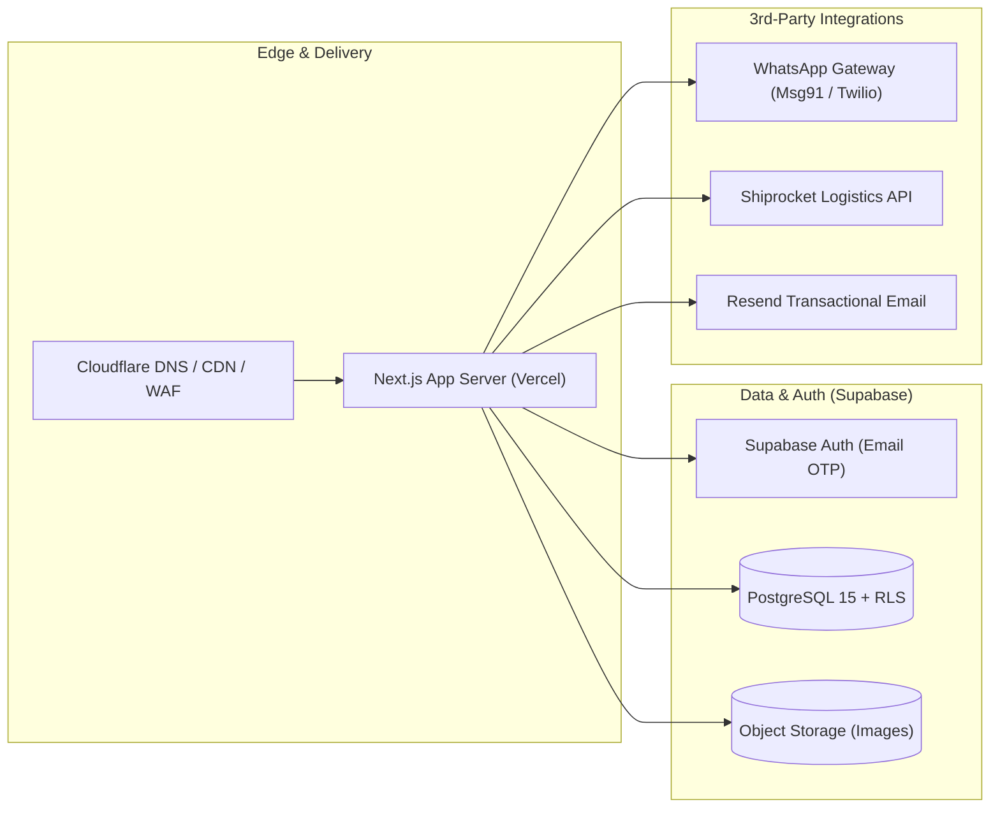

# ProjectBee – Production Deployment Guide
## Infrastructure Provisioning, Environment Variables & CI/CD Runbook

**Version:** 1.0  
**Status:** Canonical deployment guide for implementation  
**Product:** ProjectBee — *School Projects Made Easy!*  
**Target Infrastructure:** Next.js (Vercel) + Supabase (PostgreSQL 15, Auth, Storage) + Cloudflare (CDN/WAF)  

---

## 1. Architecture Topology



---

## 2. Environment Variables Configuration

Create `.env.production` (or inject into Vercel Project Settings). Never commit secrets to git.

```ini
# ==============================================================================
# PROJECTBEE PRODUCTION ENVIRONMENT VARIABLES
# ==============================================================================

# 1. APPLICATION & APP URLS
NODE_ENV=production
NEXT_PUBLIC_APP_URL=https://projectbee.in
NEXT_PUBLIC_STORE_NAME="ProjectBee"
NEXT_PUBLIC_SUPPORT_EMAIL="help@projectbee.in"
NEXT_PUBLIC_SUPPORT_PHONE="+918040000000"

# 2. SUPABASE INFRASTRUCTURE (CLIENT-SAFE)
NEXT_PUBLIC_SUPABASE_URL=https://<your-project-ref>.supabase.co
NEXT_PUBLIC_SUPABASE_ANON_KEY=eyJhbGciOi...

# 3. SUPABASE INFRASTRUCTURE (SERVER-ONLY - NEVER EXPOSE TO CLIENT)
SUPABASE_SERVICE_ROLE_KEY=eyJhbGciOi...
SUPABASE_DB_POOL_URL=postgres://postgres.<your-project-ref>:[PASSWORD]@aws-0-ap-south-1.pooler.supabase.com:6543/postgres?pgbouncer=true
SUPABASE_DB_DIRECT_URL=postgres://postgres.<your-project-ref>:[PASSWORD]@aws-0-ap-south-1.pooler.supabase.com:5432/postgres

# 4. INITIAL SUPER ADMIN BOOTSTRAP EMAIL
INITIAL_SUPER_ADMIN_EMAIL=admin@projectbee.in

# 5. WHATSAPP GATEWAY (FOR COD OTP CONFIRMATION)
WHATSAPP_PROVIDER=msg91 # "msg91" | "twilio"
WHATSAPP_AUTH_KEY=secret_auth_key_here
WHATSAPP_SENDER_ID=PRJBEE
WHATSAPP_OTP_TEMPLATE_ID=template_102938

# 6. TRANSACTIONAL EMAIL (RESEND)
RESEND_API_KEY=re_1234567890abcdef
EMAIL_FROM_ADDRESS="ProjectBee <no-reply@projectbee.in>"

# 7. LOGISTICS & COURIER (SHIPROCKET)
SHIPROCKET_API_URL=https://apiv2.shiprocket.in/v1/external
SHIPROCKET_EMAIL=logistics@projectbee.in
SHIPROCKET_PASSWORD=secure_shiprocket_password
SHIPROCKET_DEFAULT_PICKUP_LOCATION="Bengaluru Primary Hub"

# 8. SECURITY & ENCRYPTION SECRETS
OTP_HASH_SALT=secure_random_64_char_salt_string_here
INTERNAL_API_SECRET=super_secret_internal_key_for_cron_jobs
```

---

## 3. Supabase Project Setup Step-by-Step

### 3.1 Project Creation & Extensions
1. Log in to [Supabase Console](https://app.supabase.com).
2. Create a new organization and project:
   - **Name:** `ProjectBee Production`
   - **Region:** `ap-south-1 (Mumbai)` — essential for lowest latency across Indian users.
   - **Database Password:** Generate a 32-character high-entropy secret.
3. In SQL Editor, verify/enable extensions:
   ```sql
   CREATE EXTENSION IF NOT EXISTS "uuid-ossp";
   CREATE EXTENSION IF NOT EXISTS "pg_trgm";
   CREATE EXTENSION IF NOT EXISTS "citext";
   ```

### 3.2 Database Migration Execution
Apply database migrations using Supabase CLI:
```bash
# Link repository to production Supabase project
npx supabase link --project-ref <your-project-ref>

# Apply schema migrations
npx supabase db push
```

### 3.3 Storage Buckets Configuration
Create two storage buckets in the Supabase Dashboard:
1. `product-media`
   - **Public:** `true`
   - **Allowed MIME Types:** `image/jpeg`, `image/png`, `image/webp`
   - **Max File Size:** `5MB`
2. `review-images`
   - **Public:** `false` (Served via signed URLs after moderation)
   - **Allowed MIME Types:** `image/jpeg`, `image/png`, `image/webp`
   - **Max File Size:** `5MB`

### 3.4 Singleton Super Admin Account Initialization
Execute the bootstrap SQL query once in Supabase SQL editor:
```sql
-- 1. Create or verify auth user exists
-- 2. Insert into profiles with user_type = 'super_admin'
-- 3. Lock into super_admin_identity singleton (id = 1)
INSERT INTO super_admin_identity (id, profile_id, designated_at, recovery_email, notes)
VALUES (
  1, 
  '<auth_user_uuid_from_auth.users>', 
  NOW(), 
  'admin@projectbee.in', 
  'Initial Designated Super Admin Account'
) ON CONFLICT (id) DO NOTHING;
```

---

## 4. Frontend & API Deployment (Vercel)

1. Connect the GitHub repository `ProjectBee` to Vercel.
2. Select Framework Preset: `Next.js`.
3. Configure **Build & Development Settings**:
   - **Build Command:** `npm run build`
   - **Output Directory:** `.next`
   - **Install Command:** `npm install`
4. Add all production environment variables from Section 2.
5. Deploy.
6. Configure Custom Domain:
   - Add `projectbee.in` and `www.projectbee.in`.
   - Update DNS records in Cloudflare (CNAME pointing to `cname.vercel-dns.com`).

---

## 5. Cloudflare DNS, CDN & Security Rules

1. **SSL/TLS Encryption Mode:** Set to **Full (Strict)**.
2. **Always Use HTTPS:** Enabled.
3. **HTTP/3 (with QUIC):** Enabled.
4. **WAF Rate Limiting Rule:**
   - **Target:** `POST /api/v1/auth/otp/send` and `POST /api/v1/checkout/cod/send-otp`
   - **Action:** Block or Challenge if > 5 requests per minute per IP.
5. **Caching Rule:**
   - Cache static assets (`/_next/static/*`, images, fonts) with `Cache-Control: public, max-age=31536000, immutable`.
   - Bypass cache for `/api/*` and dynamic customer/dashboard routes.

---

## 6. Continuous Integration & Deployment (CI/CD)

Create `.github/workflows/deploy.yml`:

```yaml
name: ProjectBee CI/CD Pipeline

on:
  push:
    branches: [main]
  pull_request:
    branches: [main]

jobs:
  validate:
    runs-on: ubuntu-latest
    steps:
      - uses: actions/checkout@v4
      - uses: actions/setup-node@v4
        with:
          node-version: 20
          cache: 'npm'

      - name: Install Dependencies
        run: npm ci

      - name: Code Quality & Linting
        run: npm run lint

      - name: TypeScript Type Check
        run: npx tsc --noEmit

      - name: Unit & Integration Tests
        run: npm run test:coverage

  deploy:
    needs: validate
    if: github.ref == 'refs/heads/main'
    runs-on: ubuntu-latest
    steps:
      - uses: actions/checkout@v4
      - name: Deploy to Vercel Production
        uses: amondnet/vercel-action@v25
        with:
          vercel-token: ${{ secrets.VERCEL_TOKEN }}
          vercel-org-id: ${{ secrets.VERCEL_ORG_ID }}
          vercel-project-id: ${{ secrets.VERCEL_PROJECT_ID }}
          vercel-args: '--prod'
```

---

## 7. Backup, Disaster Recovery & Health Monitoring

### 7.1 Database Backups
- **Continuous Archiving:** Supabase Point-in-Time Recovery (PITR) is active with continuous Write-Ahead Log (WAL) archiving (retains 7–30 days).
- **Daily Logical Dump:** Automated GitHub Action/Cron executing `pg_dump` to an encrypted, offsite Amazon S3 bucket.

### 7.2 Post-Deployment Health Check Runbook
Immediately after each production deployment, verify:
- [ ] Storefront loads at `https://projectbee.in` in < 1.5 seconds.
- [ ] Catalog search responds for keywords: `"hydraulics"`, `"solar"`, `"biology"`.
- [ ] Customer login email OTP delivers within 15 seconds.
- [ ] Pincode serviceability lookup returns valid response for `560034` (Bengaluru).
- [ ] WhatsApp OTP test on test number confirms receipt.
- [ ] Super Admin dashboard displays live system health metrics without errors.

