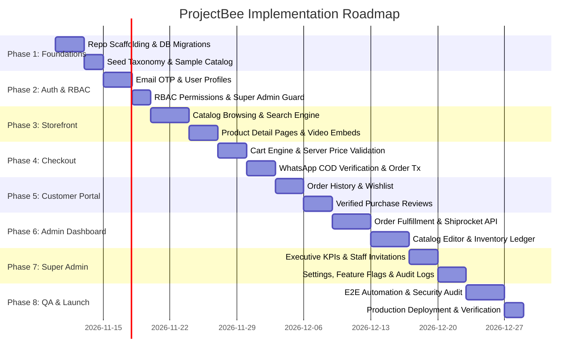

# ProjectBee – Implementation Roadmap
## Phased Development Schedule, Milestones & Engineering Sequence

**Version:** 1.0  
**Status:** Canonical implementation roadmap for Antigravity  
**Product:** ProjectBee — *School Projects Made Easy!*  
**Architecture:** Next.js (App Router), Tailwind CSS, Supabase (PostgreSQL 15), Shiprocket, WhatsApp API  

---

## 1. Executive Phasing Timeline

---

## 2. Detailed Phase Breakdown

### Phase 1: Repository Scaffolding & Database Foundations
- **Deliverables:**
  - Initialize Next.js 14+ (App Router) with TypeScript, Tailwind CSS, and shadcn/ui components.
  - Setup Supabase local development CLI and connect to cloud project.
  - Apply `DATABASE_SCHEMA.md` migrations (tables, constraints, triggers, indexes, and extensions).
  - Seed baseline academic taxonomy:
    - Boards: `CBSE`, `ICSE`, `Karnataka State Board`.
    - Classes: `Class 1` to `Class 12`.
    - Subjects: `Physics`, `Chemistry`, `Biology`, `Environmental Science`, `Mathematics`, `Robotics & Coding`, `Social Sciences`.
    - Formats: `Working Model`, `DIY Kit`, `Science Fair Display`, `Charts & Viva Preparation`.
  - Seed 15 representative school projects across primary, middle, and secondary classes.
- **Completion Criteria:** `npx supabase db reset` seeds all tables and sample data cleanly without errors.

---

### Phase 2: Authentication, Identity & Access Control (RBAC)
- **Deliverables:**
  - Supabase Auth integration using passwordless Email OTP.
  - Profile creation hook on `auth.users` insert.
  - Single Super Admin account binding (`super_admin_identity` check).
  - RBAC permission evaluation helper (`has_permission(auth.uid(), permission)`).
  - Unified session middleware protecting `/dashboard/*` and `/api/v1/admin/*` routes.
- **Completion Criteria:** Customer receives OTP via email, logs in, and unauthorized access to `/dashboard` redirects to login.

---

### Phase 3: Public Customer Storefront & Search Engine
- **Deliverables:**
  - **Homepage:** Hero banner, quick-filter by Class (1–12), Subject icons, and Featured School Science Fair Projects.
  - **Catalog Listing Page:**
    - Sidebar filter: Boards (CBSE/ICSE), Classes (1–12), Academic Groups, Subjects, Price slider, and Product Formats.
    - Full-text search with debounce (300ms) and `pg_trgm` typo tolerance.
  - **Product Detail Page (PDP):**
    - High-resolution photo gallery with zoom.
    - Specifications: Dimensions, Weight, Assembly requirements, Safety notes, and Included concept guides.
    - Embedded demonstration media (YouTube Shorts / Reels).
    - Pincode delivery estimator checking `serviceable_pincodes`.
- **Completion Criteria:** Visitor can filter for "Class 8 CBSE Physics Working Models", search "hydraulik", and view responsive PDP with all specs.

---

### Phase 4: Cart & Cash on Delivery (COD) Checkout Engine
- **Deliverables:**
  - Persistent shopping cart (local storage for guests, synchronized database cart for authenticated users).
  - Server-side price, coupon, and stock validation before checkout.
  - Checkout form capturing mandatory Parent/Guardian Name, Phone, Delivery Address, and Student details.
  - WhatsApp OTP verification service adapter (Msg91 / Twilio).
  - Atomic order placement transaction (`reserve_order_stock` + order creation + snapshot recording).
  - Order confirmation screen with unique order number (e.g. `PB-202611-0042`).
- **Completion Criteria:** Placing an order decrements stock on hand, locks order item pricing snapshots, and triggers confirmation WhatsApp message.

---

### Phase 5: Customer Portal & Verified-Purchase Reviews
- **Deliverables:**
  - Customer "My Account" area: Profile details, saved delivery addresses, and wishlist.
  - Order tracking page displaying real-time shipment timeline.
  - Pre-dispatch order cancellation with mandatory reason.
  - Verified-purchase review engine:
    - Server verifies order status is `delivered` before allowing review submission.
    - Rating (1–5 stars), review title, feedback text, and optional photo upload.
    - Privacy-safe reviewer display name generation (e.g. `Priya S., Class 6 Parent`).
    - Recalculates product rating average and count via database trigger.
- **Completion Criteria:** Customer who received delivery submits a review, which immediately updates the product's aggregate rating.

---

### Phase 6: Unified Admin Dashboard (E-Commerce Operations)
- **Deliverables:**
  - Role-adaptive dashboard layout (nav items render based on effective user permissions).
  - **Order Operations Center:**
    - Filter orders by status (`confirmed`, `processing`, `packed`, `shipped`, `delivered`).
    - Status advancement workflow with internal operational notes.
    - Shiprocket integration: generate AWB, print courier shipping labels and packing slips.
  - **Catalog Manager:** Product creation/editing, multi-class mapping, format assignment, and photo uploads to Supabase storage.
  - **Inventory Ledger:** Low-stock alerts, manual stock adjustments with mandatory audit reason.
  - **Review Moderation Queue:** Review uploaded customer photos, redact school badges/faces, approve or reject.
- **Completion Criteria:** Operations staff can advance an order from `confirmed` to `shipped` and print the generated courier label.

---

### Phase 7: Super Admin Central Control Center
- **Deliverables:**
  - **Executive KPI Dashboard:** Real-time GMV, COD delivery success rate, cancellation rate, top-selling grades and subjects.
  - **Staff Management:**
    - Send single-use time-bound invitation emails to new administrators.
    - Role assignments and individual granular allow/deny permission overrides.
    - Account suspension toggle.
  - **Global Configuration Editor:** Update COD thresholds, support phone, shipping fees, and policies.
  - **Feature Toggles Switchboard:** Real-time toggles for `whatsapp_otp`, `product_qa`, `promotions`.
  - **Audit Log Explorer:** Searchable, immutable event ledger tracking all admin and system mutations.
  - **System Health Monitor:** Live integration status for Supabase, WhatsApp API, Shiprocket, and backups.
- **Completion Criteria:** Super Admin invites an operations manager, grants custom permissions, and audits the event in the log ledger.

---

### Phase 8: Quality Assurance, Security Hardening & Launch
- **Deliverables:**
  - Execute Vitest unit and integration test suites (> 85% coverage).
  - Execute Playwright E2E customer checkout and admin fulfillment scenarios.
  - Run pgTAP RLS security tests to verify zero data leakage between customer accounts.
  - Execute k6 load test on concurrent checkouts to confirm zero overselling.
  - Configure Cloudflare WAF, SSL Full (Strict), and rate-limiting rules.
  - Production deployment on Vercel and Supabase.
  - Final smoke test runbook execution.
- **Completion Criteria:** All test suites pass 100%, security audit is green, and the production site is live at `https://projectbee.in`.

