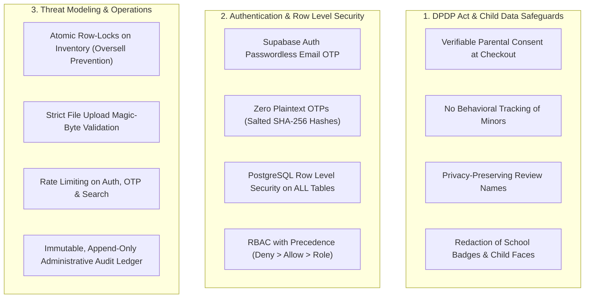

# ProjectBee – Security & Compliance Checklist
## Data Privacy, Child Safety, RLS & Infrastructure Security Blueprint

**Version:** 1.0  
**Status:** Canonical security standard for implementation  
**Product:** ProjectBee — *School Projects Made Easy!*  
**Applicable Regulations:** Digital Personal Data Protection (DPDP) Act (India), POCSO Safeguards, CERT-In Guidelines  

---

## 1. Executive Summary

Because ProjectBee sells educational and science projects intended for school students (Classes 1–12), **child data protection, parental verification, and robust data isolation** are critical legal and ethical obligations.



---

## 2. Digital Personal Data Protection (DPDP) & Child Privacy

| Ref | Requirement | Implementation Mechanism | Verification Test |
| :--- | :--- | :--- | :--- |
| **DP-01** | **Parent/Guardian Consent** | Mandatory collection of Parent/Guardian Name, Phone, and WhatsApp confirmation on every order. | Orders reject submission if parent fields are null or empty. |
| **DP-02** | **No Behavioral Profiling of Minors** | No invasive third-party ad pixels (e.g. Meta pixel tracking child browsing patterns). Minimal first-party analytics only. | Audit network requests to verify absence of ad trackers. |
| **DP-03** | **Privacy-Preserving Review Display** | Reviews never display a minor's full name, phone number, school name, or exact address. Format: `Parent Name, Class X Parent`. | Inspect public review API payloads to confirm PII exclusion. |
| **DP-04** | **Review Photograph Moderation** | Uploaded review photos must be human-moderated before publication to ensure no school ID badges or child faces are inappropriately exposed. | Review images default to `moderation_status: pending`. |
| **DP-05** | **Data Principal Rights (Access & Erasure)** | `customer_data_requests` table tracks statutory DPDP requests for data export, correction, and account deletion. | Admin dashboard provides automated export and pseudonymized deletion. |
| **DP-06** | **Optional Student Profiles** | Student grade, school, and academic preferences remain strictly optional. Guest and non-profile checkout is fully supported. | Profile completion is never gated before purchase. |

---

## 3. Database Security & Row Level Security (RLS)

All public tables must enforce PostgreSQL RLS. The application connection uses Supabase `authenticated` and `anon` roles with least privilege.

```sql
-- Security Baseline Rule: Deny by default across every schema table
ALTER TABLE profiles ENABLE ROW LEVEL SECURITY;
ALTER TABLE customer_profiles ENABLE ROW LEVEL SECURITY;
ALTER TABLE admin_accounts ENABLE ROW LEVEL SECURITY;
ALTER TABLE super_admin_identity ENABLE ROW LEVEL SECURITY;
ALTER TABLE admin_invitations ENABLE ROW LEVEL SECURITY;
ALTER TABLE products ENABLE ROW LEVEL SECURITY;
ALTER TABLE inventory ENABLE ROW LEVEL SECURITY;
ALTER TABLE stock_movements ENABLE ROW LEVEL SECURITY;
ALTER TABLE orders ENABLE ROW LEVEL SECURITY;
ALTER TABLE order_items ENABLE ROW LEVEL SECURITY;
ALTER TABLE reviews ENABLE ROW LEVEL SECURITY;
ALTER TABLE audit_logs ENABLE ROW LEVEL SECURITY;
```

### RLS Verification Matrix

| Table | `anon` (Public / Guest) | `authenticated` (Customer) | `authenticated` (Admin) | `authenticated` (Super Admin) |
| :--- | :--- | :--- | :--- | :--- |
| `products` | SELECT (if `status = 'published'`) | SELECT (if `published`) | FULL (if `products.manage` grant) | FULL (Bypass via `is_super_admin`) |
| `inventory` | NO ACCESS (Virtual stock queried via RPC) | NO ACCESS | SELECT / UPDATE (`inventory.adjust`) | FULL |
| `orders` | NO ACCESS | SELECT / INSERT (Own orders: `auth.uid() = customer_id`) | SELECT / UPDATE (`orders.view` / `orders.update_status`) | FULL |
| `order_items` | NO ACCESS | SELECT (Linked to own orders) | SELECT (`orders.view`) | FULL |
| `reviews` | SELECT (if `status = 'approved'`) | INSERT (Verified purchase only) | FULL (`reviews.moderate`) | FULL |
| `audit_logs` | NO ACCESS | NO ACCESS | NO ACCESS | SELECT ONLY (Append-only by server) |
| `super_admin_identity` | NO ACCESS | NO ACCESS | NO ACCESS | SELECT ONLY |

---

## 4. Authentication & Secret Management

### 4.1 One-Time Passcode (OTP) Hardening
- **Email OTP:**
  - Length: 6 digits (cryptographically secure random integer).
  - Expiry: 10 minutes.
  - Cooldown: 60 seconds per email.
  - Max Attempts: 3 failed attempts invalidates the OTP.
- **WhatsApp COD Verification OTP:**
  - Plaintext OTP is **never stored in the database**.
  - Generated OTP is hashed with a server-side salt using SHA-256 before insertion into `cod_verifications.otp_hash`.
  - Max Attempts: 5 failed attempts per order token.
  - Expiry: 10 minutes.

### 4.2 Super Admin Account Singleton
- Exactly **one** designated Super Admin account (`id = 1` check constraint in `super_admin_identity`).
- Super Admin cannot be created via public sign-up or admin self-promotion.
- Privileges are bound to the immutable `auth.users.id` in PostgreSQL.

### 4.3 Secret Storage & Provider Credentials
- No API keys, database credentials, or gateway secrets stored in git or client bundles.
- Environment variables:
  - `SUPABASE_SERVICE_ROLE_KEY`: Server-only environment variable.
  - `WHATSAPP_API_TOKEN`: Server-only.
  - `SHIPROCKET_API_TOKEN`: Server-only.
  - `RESEND_API_KEY`: Server-only.
- Public client bundle only receives `NEXT_PUBLIC_SUPABASE_URL` and `NEXT_PUBLIC_SUPABASE_ANON_KEY`.

---

## 5. Threat Modeling & Defensive Controls

```
+-------------------------------------------------------------------------------+
|                             THREAT MITIGATION MATRIX                          |
+------------------------------------+------------------------------------------+
| Threat                             | ProjectBee Mitigation Control            |
+------------------------------------+------------------------------------------+
| 1. SQL Injection (SQLi)            | Parameterized SQL / Supabase PostgREST  |
| 2. Cross-Site Scripting (XSS)      | Strict React JSX escaping + CSP Headers  |
| 3. Cross-Site Request Forgery      | SameSite=Lax/Strict Cookies + CSRF Token |
| 4. Inventory Overselling           | PostgreSQL Row Lock: SELECT ... FOR UPDATE|
| 5. Malicious File Uploads          | Magic-byte validation + Private Buckets  |
| 6. Review Astroturfing/Fake Votes  | Server-verified purchase check + RLS     |
| 7. Administrative Tampering        | Append-only immutable `audit_logs`       |
| 8. Denial of Service (DoS)         | Upstream Cloudflare + IP Rate-limiting   |
+------------------------------------+------------------------------------------+
```

### 5.1 Content Security Policy (CSP) Headers
```http
Content-Security-Policy: default-src 'self'; script-src 'self' 'unsafe-inline'; style-src 'self' 'unsafe-inline' https://fonts.googleapis.com; img-src 'self' data: https://cdn.projectbee.in https://*.supabase.co https://images.openai.com; frame-src https://www.youtube.com https://www.instagram.com; connect-src 'self' https://*.supabase.co;
X-Content-Type-Options: nosniff
X-Frame-Options: DENY
Referrer-Policy: strict-origin-when-cross-origin
Permissions-Policy: camera=(), microphone=(), geolocation=()
```

### 5.2 File Upload Validation Checklist
Review image and product image uploads must enforce:
1. **Allowed Extensions:** `.jpg`, `.jpeg`, `.png`, `.webp`.
2. **File Size Limit:** Maximum 5 MB per image.
3. **Magic Byte Verification:** Inspect file binary header (`FF D8 FF` for JPEG, `89 50 4E 47` for PNG, `52 49 46 46` for WEBP) to prevent disguised executable scripts (`.php`, `.exe`, `.sh`).
4. **Isolated Storage:** Uploaded files stored in Supabase Storage with randomized UUID paths (`/reviews/{productId}/{uuid}.webp`).

---

## 6. Pre-Launch Security Audit Checklist

- [ ] **RLS Verification:** Run automated test asserting that unauthenticated requests to `/orders`, `/inventory`, and `/audit_logs` return empty sets or `403 Forbidden`.
- [ ] **OTP Security:** Verify OTP plaintext never appears in application logs or database rows.
- [ ] **Parental Consent:** Confirm order submission fails if parent name and WhatsApp number are omitted.
- [ ] **Verified Purchase Enforcement:** Verify that submitting a review for a non-delivered order fails server-side with `403 Forbidden`.
- [ ] **Stock Concurrency Test:** Execute 10 simultaneous orders against 1 remaining stock item to prove zero overselling.
- [ ] **Audit Trail Completeness:** Verify all status transitions, stock adjustments, and admin invitations generate immutable entries in `audit_logs`.
- [ ] **SSL / TLS:** Enforce TLS 1.3 with HSTS (`Strict-Transport-Security: max-age=63072000; includeSubDomains; preload`).
- [ ] **Disaster Recovery:** Verify automated WAL backups and test point-in-time recovery on staging database.

