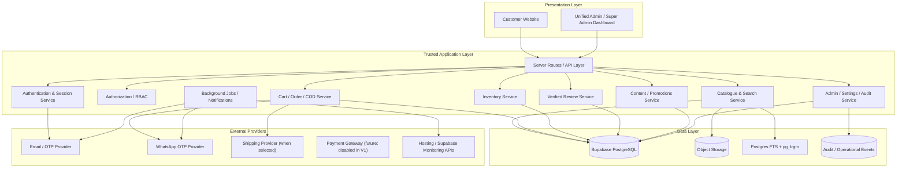

# ProjectBee – Technical Architecture
## Shared Application, Database, API, Security and Integration Blueprint

**Version:** 1.0  
**Status:** Architecture baseline for Antigravity planning  
**Product:** ProjectBee – School Projects Made Easy!  
**Tagline:** School Projects Made Easy!  
**Initial market:** India  
**Initial boards:** CBSE and ICSE  
**Classes:** 1–12  
**Initial payment method:** Cash on Delivery (COD) only  
**Primary backend direction:** Supabase / PostgreSQL  
**Development tool:** Antigravity

---

## 1. Purpose

This document defines the shared technical architecture for the three ProjectBee product requirement documents:

1. `PRD.md` – Customer-facing e-commerce website.
2. `ADMIN_PRD.md` – Admin dashboard.
3. `SUPER_ADMIN_PRD.md` – Super Admin dashboard.

The three experiences must be implemented as one integrated platform, with one source of truth for products, catalogue taxonomy, customers, orders, inventory, reviews, content, settings, identity, roles and permissions.

This document is a blueprint, not permission to replace an existing working stack. Antigravity must inspect the current repository, package files, deployment setup, database and existing code before selecting or changing framework-specific implementation details.

## 2. Architecture principles

1. **One platform, shared data:** Customer, Admin and Super Admin interfaces use the same backend and canonical data.
2. **PostgreSQL is the source of truth:** Supabase PostgreSQL is the planned transactional database.
3. **Server-side trust:** Pricing, stock, order creation, COD verification, review eligibility, permissions and privileged settings are validated on trusted server-side code.
4. **Least privilege:** Deny access by default. Admin permissions are explicit and server-enforced.
5. **Single Super Admin:** Exactly one designated Super Admin account in the initial release.
6. **One dashboard shell:** Admin and Super Admin use one role-aware dashboard application.
7. **Configuration-driven taxonomy:** Classes, boards, subjects, categories and mappings are data, not hardcoded page logic.
8. **Auditable operations:** Important administrative and sensitive data-access actions produce protected audit events.
9. **Privacy by design:** ProjectBee serves school students, including minors. Minimise data, limit access and avoid unnecessary behavioural profiling.
10. **Vendor boundaries:** Keep core business logic independent of email, WhatsApp/SMS, shipping, payment and monitoring vendors.
11. **No fake capability:** Show unavailable provider metrics as unavailable; do not simulate successful integrations, delivery, backups or restores.
12. **Build in phases:** Secure identity, authorization and transactional foundations before broad dashboard features.

## 3. Product scope and baseline decisions

| Area | Initial decision |
|---|---|
| Market | India-wide |
| Operational base | Bengaluru |
| Currency | INR |
| Timezone | Asia/Kolkata |
| Website language | English |
| Search language | English |
| Academic boards | CBSE and ICSE |
| Classes | 1–12 |
| Customer auth | Passwordless email OTP |
| Admin auth | Passwordless email OTP |
| Super Admin auth | Passwordless email OTP |
| Super Admin count | Exactly one |
| Admin provisioning | Manual invitation by Super Admin |
| Admin permissions | Predefined roles + custom roles + individual overrides |
| Admin action approval | No Super Admin approval queue |
| Audit | Comprehensive audit logs |
| Checkout | COD only in V1 |
| COD phone check | WhatsApp OTP before confirming COD order |
| Reviews | Verified purchase only; delivered eligible order |
| Product videos | External YouTube/Instagram/Facebook links; do not rehost videos |
| Storage | Supabase Storage or approved equivalent, after repository review |
| Search | PostgreSQL full-text search + typo tolerance (`pg_trgm`) |
| Monitoring | Detailed monitoring only for metrics exposed by actual providers |
| Notifications | Dashboard + email for Super Admin alerts |
| Backup | Monitor provider backups; manual recovery only where provider supports it |

## 4. High-level logical architecture



This diagram is logical. It does not require a separate microservice for every box. For V1, use a modular monolith or a small number of server-side modules/functions unless measured scale or deployment constraints justify service separation.

## 5. Application structure

### 5.1 Three experiences

**Customer website**
- Public pages and catalogue browsing.
- Search, filters, product details and media links.
- Cart and COD checkout.
- Customer email OTP login.
- Optional student profile.
- Orders, wishlist, reviews and account features.

**Unified dashboard**
- Shared layout, navigation, tables, forms and design tokens.
- Admin navigation/action visibility derived from effective permissions.
- Super Admin receives full access.
- Direct URL and API access still checked server-side.
- No separate duplicate Admin and Super Admin applications.

### 5.2 Repository organization

Antigravity must first inspect the existing repository and retain its current framework and conventions. If a modular structure is useful, use an equivalent of:

```text
projectbee/
  app-or-src/
    customer/
    dashboard/
    api/
  components/
    shared/
    customer/
    dashboard/
  modules/
    identity/
    authorization/
    catalogue/
    search/
    cart/
    orders/
    inventory/
    reviews/
    customers/
    content/
    promotions/
    shipping/
    notifications/
    audit/
    settings/
    monitoring/
    backups/
  lib/
    database/
    validation/
    security/
    providers/
  supabase/
    migrations/
    functions/
    seed/
  tests/
    unit/
    integration/
    e2e/
  docs/
```

Do not move or restructure an existing repository merely to match this illustrative layout.

## 6. Identity, authentication and account model

### 6.1 Identity provider

Use Supabase Auth if it supports the selected email OTP flow and current project configuration. Inspect existing auth configuration before changing it.

- Customers authenticate using email OTP.
- Admins authenticate using email OTP after invitation.
- Super Admin authenticates using email OTP for the one pre-provisioned identity.
- No password-based login is introduced in V1.
- Do not rely on user-editable metadata for privileged roles.

### 6.2 Identity records

Use the auth provider's immutable user ID as the canonical identity key. Maintain application profile and access records in PostgreSQL linked to that ID.

Logical entities:

- `profiles`: common profile fields and account state.
- `customer_profiles`: optional customer/student profile data if separate from common profile.
- `admin_accounts`: Admin-specific state and invitation metadata.
- `super_admin_identity`: singleton record or equivalent protected configuration binding the one Super Admin auth user.
- `admin_invitations`: single-use invitation metadata.
- Provider-managed auth/session tables remain owned by the auth provider.

Avoid duplicating password or OTP credential storage in application tables.

### 6.3 Customer profile

Customer account profile must remain progressive and optional.

Potential fields, only where justified:
- Display/name.
- Gender including “Prefer not to say” if retained in product design.
- Class 1–12.
- Board CBSE/ICSE.
- Academic group derived from class.
- Optional interests and favourite subjects.
- Optional city/state where there is a clear purpose.

Do not require profile completion for browsing or normal use. Delivery address is collected in checkout, not inferred from optional profile location.

### 6.4 Admin invitation lifecycle

1. Super Admin enters name and email.
2. Server checks uniqueness and permission.
3. Create pending invitation with secure, single-use token metadata and expiry.
4. Send invitation email.
5. Admin opens invitation and verifies the same email via OTP.
6. Server validates invitation state, expiry and identity match.
7. Activate Admin account and assign initial role/overrides.
8. Audit each lifecycle action.

Resend invalidates older invitation tokens. Pending, suspended and deactivated users cannot access protected dashboard APIs.

### 6.5 Single Super Admin enforcement

- Provision through secure deployment/bootstrap, not public registration.
- Store identity binding server-side.
- Enforce singleton at database/application layers.
- Do not allow Admin promotion.
- Do not create hidden backup Super Admin accounts.
- Document infrastructure-owner recovery if the account is inaccessible.
- Any identity change must be a controlled, audited deployment-level procedure.

## 7. Authorization architecture (RBAC + overrides)

### 7.1 Model

Use role-based access control with individual Admin permission overrides.

Suggested logical tables:

- `roles`
- `permissions`
- `role_permissions`
- `admin_role_assignments`
- `admin_permission_overrides`

Permission examples:
- `products.view`
- `products.create`
- `products.update`
- `products.delete`
- `products.publish`
- `inventory.adjust`
- `orders.view`
- `orders.update_status`
- `customers.view_limited`
- `customers.view_sensitive`
- `reports.export`
- `reviews.moderate`
- `content.publish`

### 7.2 Effective permission calculation

- Super Admin: full platform authority.
- Admin: start with no access; union assigned role grants, then apply explicit individual overrides according to a documented precedence rule.
- Explicit deny should override role grant.
- Do not permit Admins to edit their own role assignments or permission overrides.
- Admins cannot manage Super Admin identity or platform-level security.
- Super Admin alone provisions Admin accounts and governs roles.

The precedence rule must be implemented once in a shared authorization module and tested. Recommended: explicit user deny wins; otherwise explicit user allow wins; otherwise role grants apply; otherwise deny.

### 7.3 Enforcement

Every protected action must be checked:
1. At the server/API boundary.
2. In database RLS policies for direct data access paths.
3. In privileged database functions where needed.

Frontend hiding is only a usability feature, not a security control.

### 7.4 RLS design

- Enable RLS on all tables exposed through Supabase APIs.
- Deny public access to private records by default.
- Use narrowly scoped policies.
- Do not put service-role keys in browser code.
- For privileged operations, use trusted server-side code or carefully secured database functions.
- Avoid broad policies such as “authenticated users can read all rows.”
- Test both allowed and denied cases for each role.

## 8. Database design

Use PostgreSQL relational integrity, foreign keys, unique constraints, check constraints, indexes and transactions. The following is a logical model; Antigravity must reconcile it with the existing schema and generate reviewed migrations. Do not blindly create duplicate entities.

### 8.1 Core identity and authorization

| Entity | Purpose | Key relationships |
|---|---|---|
| `profiles` | Common account profile | auth user ID |
| `customer_profiles` | Optional customer/student profile | profile/user |
| `admin_accounts` | Admin status and metadata | profile/user |
| `super_admin_identity` | Single privileged identity binding | auth user ID |
| `admin_invitations` | Pending/used/revoked invitations | creator/admin |
| `roles` | Predefined/custom role definitions | role permissions |
| `permissions` | Permission catalogue | role permissions |
| `role_permissions` | Role grants | role + permission |
| `admin_role_assignments` | Admin role mapping | admin + role |
| `admin_permission_overrides` | Per-admin allow/deny | admin + permission |

### 8.2 Academic taxonomy and catalogue

| Entity | Purpose |
|---|---|
| `boards` | CBSE, ICSE initial values |
| `classes` | Classes 1–12 |
| `academic_groups` | Early Learners, Primary, Middle, Secondary, Senior Secondary |
| `subjects` | Curriculum subjects |
| `categories` | Product categories and subcategories |
| `product_formats` | Working model, chart, file, kit, etc. |
| `products` | Canonical product record |
| `product_images` | Image object keys, ordering, alt text |
| `product_boards` | Many-to-many board mapping |
| `product_classes` | Many-to-many class mapping |
| `product_subjects` | Many-to-many subject mapping |
| `product_categories` | Many-to-many category mapping if multiple categories are required |
| `product_keywords` | Search terms and tags |
| `search_synonyms` | Managed English synonyms |
| `product_social_links` | External video/social URLs and platform metadata |
| `product_variants` | Optional variants if business confirms they are needed |

Products can apply to multiple classes, boards and subjects. Avoid storing a single class/board foreign key on product as the only mapping.

Suggested product lifecycle:
- Draft
- Published
- Unpublished
- Archived
- Deleted/soft-deleted where legally and operationally appropriate

Published products require valid price, required taxonomy, images/specifications according to business rules and availability state.

### 8.3 Pricing and inventory

| Entity | Purpose |
|---|---|
| `product_prices` or product price fields | Current selling/list price |
| `price_history` | Historical price changes |
| `inventory` | Current stock by product/variant/location if needed |
| `stock_movements` | Immutable stock ledger |
| `inventory_adjustments` | Reason and actor for manual adjustment |

Stock changes must be transactional. Do not rely on a browser-calculated stock value. Record movement type, quantity delta, reference, actor and timestamp.

Do not introduce multiple warehouses in V1 unless the business confirms that need. Design keys so it can be added later.

### 8.4 Cart and orders

| Entity | Purpose |
|---|---|
| `carts` | Active customer cart |
| `cart_items` | Product and quantity |
| `orders` | Order header and status |
| `order_items` | Immutable purchase-time item snapshots |
| `order_status_events` | Status timeline |
| `order_addresses` | Purchase-time shipping/billing address snapshot |
| `cod_verifications` | WhatsApp OTP verification metadata, never OTP plaintext |
| `shipments` | Shipment and carrier reference |
| `shipment_events` | Tracking timeline |
| `cancellations` | Cancellation reason and status |
| `returns` | Return request and outcome |
| `cod_reconciliations` | COD collection/reconciliation where supported |

Order item snapshots should preserve product title, SKU/reference, unit price, quantity, tax/discount components where applicable and other purchase-time details. Later product edits must not rewrite historical order details.

### 8.5 Customer data

| Entity | Purpose |
|---|---|
| `customer_addresses` | Saved delivery addresses |
| `customer_data_requests` | Privacy access/correction/deletion request tracking |
| `customer_support_tickets` | Support cases |
| `support_messages` | Ticket conversation messages |

Checkout must capture parent/guardian name and WhatsApp number as required by the customer PRD. WhatsApp OTP verifies control of the phone number only; it does not establish guardianship or legal consent.

### 8.6 Reviews and engagement

| Entity | Purpose |
|---|---|
| `reviews` | Rating and review text |
| `review_images` | Validated image attachments |
| `review_reports` | User reports |
| `review_helpful_votes` | Helpful vote records |
| `wishlists` | Customer wishlist |
| `wishlist_items` | Saved products |
| `product_questions` | Product questions if feature enabled |
| `product_answers` | Responses if Q&A is enabled |

Verified review eligibility must be derived server-side from delivered eligible order items. Initial policy: one review per customer/product/order combination. Store a reference to the qualifying order item or order/product combination. Prevent duplicate submissions using database constraints and transaction-safe checks.

Do not permit self-reported “verified” flags from the browser.

### 8.7 Content and promotions

| Entity | Purpose |
|---|---|
| `banners` | Homepage/banner content |
| `content_pages` | Static and policy pages |
| `faqs` | FAQ records |
| `navigation_items` | Managed navigation where required |
| `coupons` | Coupon definitions |
| `promotions` | Campaign definitions |
| `promotion_products` | Campaign/product mapping |
| `featured_products` | Curated placements |
| `seo_metadata` | Page/product SEO metadata where separate fields are useful |

### 8.8 Shipping and serviceability

| Entity | Purpose |
|---|---|
| `shipping_zones` | Configured zones |
| `serviceable_pincodes` | Serviceability lookup |
| `shipping_rules` | Fee and free-shipping rules |
| `shipments` | Shipment references |
| `shipment_events` | Tracking updates |

The actual courier and serviceability data provider remain open until selected. Provide a manual operational fallback if no provider API is available.

### 8.9 Settings, features, audit and operations

| Entity | Purpose |
|---|---|
| `global_settings` | Typed non-secret platform settings |
| `feature_flags` | Basic ON/OFF feature controls |
| `audit_logs` | Protected administrative/security event ledger |
| `notifications` | In-dashboard notifications |
| `notification_preferences` | Non-critical preference controls |
| `notification_delivery_logs` | Email/integration delivery outcomes |
| `integration_status` | Safe provider status metadata only |
| `system_alerts` | Operational incidents |
| `backup_records` | Provider backup metadata where available |
| `recovery_operations` | Recovery requests and provider operation status |
| `background_job_runs` | Job execution status and safe error summaries |

Secrets must not be stored in ordinary settings rows. Use secure server-side environment/secret management.

### 8.10 Data conventions

- Use UUID primary keys for application entities unless existing conventions differ.
- Use `timestamptz` for timestamps and store UTC; render business time in Asia/Kolkata.
- Use `numeric`/integer paise for money, never floating-point.
- Store currency explicitly where multi-currency may eventually matter; INR initially.
- Use foreign keys and appropriate delete restrictions.
- Prefer archive/deactivate for referenced catalogue/taxonomy records.
- Add `created_at`, `updated_at` and actor IDs where relevant.
- Add indexes for common filters, joins, search and foreign keys.
- Use unique constraints to prevent duplicate mappings and duplicate eligible reviews.
- Define enum/check constraints or lookup tables consistently; do not mix ad-hoc strings without validation.

## 9. Search architecture

Use PostgreSQL as the initial search engine.

### 9.1 Search fields

- Product title.
- Short/full description.
- Board and class.
- Subject.
- Category.
- Product format.
- Keywords/tags.
- Managed English synonyms.

### 9.2 Search implementation

- PostgreSQL Full Text Search with an English configuration.
- `pg_trgm` for typo-tolerant matching.
- GIN indexes for text search/trigram fields where appropriate.
- A server-side search function/RPC or parameterised query.
- Filters for class, board, subject, category, format, difficulty, price and availability.
- Ranking: exact title, title phrase, class/subject/board relevance, category/format, keywords/synonyms, typo-tolerant match.
- Debounce client input and paginate results.
- Track minimal aggregate search analytics and zero-result terms.

Do not allow client-provided SQL fragments or unbounded search queries. Search must not silently restrict results based on optional profile class when the visitor explicitly searches another class.

## 10. Commerce and order processing

### 10.1 Cart

- Guest cart behaviour must follow the final customer PRD decision.
- Signed-in cart is linked to the customer.
- Server recalculates product price, availability, coupon eligibility and shipping.
- Never trust client-submitted prices or discounts.
- Validate quantity and stock before order creation.

### 10.2 COD-only checkout V1

- Online payment gateway is not active in V1.
- Create order using server-calculated totals.
- Capture parent/guardian name and WhatsApp number.
- Send WhatsApp OTP to the submitted number through configured provider.
- Verify OTP server-side before confirming the COD order.
- Store verification metadata, provider reference and timestamps; never store OTP plaintext.
- Phone verification proves control of the number, not guardianship or legal consent.
- Handle provider timeout/failure with a clear retry path; do not confirm an order if required verification has not succeeded.
- Protect order creation against duplicate submissions with idempotency keys or equivalent transaction-safe design.

### 10.3 Order transaction

A trusted server-side operation should:
1. Validate customer/session and checkout fields.
2. Load current product and stock data.
3. Validate quantity and product status.
4. Recalculate price, discounts, shipping and tax components according to approved rules.
5. Confirm required COD phone verification.
6. Reserve or decrement stock atomically according to the chosen inventory policy.
7. Create order and immutable order-item/address snapshots.
8. Create initial status event.
9. Commit transaction.
10. Trigger confirmation notifications asynchronously.

The exact stock reservation policy, COD confirmation timing and order status state machine must be documented before production.

### 10.4 Order status

Use a documented finite-state workflow. Candidate statuses include:
- Pending verification
- Confirmed
- Processing
- Packed
- Shipped
- Out for delivery
- Delivered
- Cancelled
- Return requested
- Returned
- Failed delivery

Do not implement every status without confirming the actual operational flow. Enforce valid transitions server-side and record each transition in `order_status_events`.

### 10.5 COD and future payment readiness

Keep a payment/collection abstraction so online payments can be added later, but do not show online payment options in V1. A future payment gateway must use provider webhooks with signature verification and idempotent event handling.

## 11. Inventory architecture

- Maintain a stock ledger.
- Every adjustment creates a `stock_movements` record.
- Stock quantity changes and order creation must be transactional.
- Prevent overselling with row locks, atomic updates or equivalent concurrency-safe SQL.
- Validate stock again at checkout.
- Define treatment of cancelled orders, failed deliveries and returns.
- Bulk adjustments require validation, preview and confirmation.
- Keep reason, actor, reference and timestamp for manual changes.

## 12. Reviews and customer engagement

- Only eligible delivered purchases may create reviews.
- Eligibility is calculated on server from trusted order/order-item data.
- Database uniqueness prevents duplicate review per customer/product/order.
- Ratings are 1–5.
- Review text and photos pass validation and moderation rules.
- Helpful votes are unique per user/review where authenticated.
- Reported content enters a moderation workflow.
- Negative sentiment alone is not grounds for removal.
- Admin moderation actions are audited.
- Feature toggles can disable new submissions or display without deleting historical reviews.

## 13. Media and file storage

### 13.1 Product images

Use Supabase Storage or the existing approved object storage.

- Store object keys/paths in database, not long-lived public tokens.
- Use public read access only for intentionally public published product images.
- Restrict write/delete operations to authorised server-side Admin workflows.
- Validate file type, MIME type, size and image dimensions.
- Generate safe image variants/thumbnails where appropriate.
- Use alt text and stable sort order.
- Prevent executable or unsafe uploads.

### 13.2 Review images and private files

- Use private buckets or protected access where appropriate.
- Enforce ownership and permission checks.
- Generate short-lived signed URLs for private content.
- Validate uploads and apply moderation.
- Do not expose internal storage paths as authorization.

### 13.3 External product videos

- Store validated YouTube, Instagram and Facebook URLs and platform metadata.
- Do not download or rehost videos.
- Use official embeds only where permitted and supported.
- Provide a safe external link fallback.
- Restrict embed origins and sanitize URLs.
- Avoid autoplay and respect privacy/cookie choices where applicable.

## 14. Global settings and feature toggles

### 14.1 Global settings

Store non-secret, typed configuration values in `global_settings`, with key, type, validated value, description, update timestamp and actor. Keep provider secrets in server-side secret storage.

Potential setting groups:
- Business and contact.
- Website and SEO.
- Academic taxonomy references.
- Shipping and serviceability.
- COD rules.
- OTP and session limits.
- Notification templates/preferences.
- Review policy.
- Maintenance mode.

### 14.2 Feature flags

Use simple ON/OFF flags for:
- Customer registration.
- Guest browsing.
- Guest checkout.
- Wishlist.
- Ratings and reviews.
- Product Q&A.
- Product videos/social links.
- Recently viewed products.
- Coupons/promotions.
- WhatsApp OTP.
- COD.

Feature state must be enforced server-side as well as reflected in UI. Disabling a feature must not delete existing records or break historical order display.

## 15. Audit, notifications and background jobs

### 15.1 Audit events

Write audit events from trusted server-side operations, not client-submitted claims.

Capture actor, role snapshot, action, module, record ID, timestamp, outcome, request/correlation ID and safe before/after values. Capture IP/user-agent where available and justified. Redact OTPs, tokens, secrets and unnecessary personal data.

Ordinary Admins cannot modify or delete audit logs. Super Admin should not have a normal UI function to rewrite historical events. Use database permissions/append-only patterns and a documented retention policy.

### 15.2 Notifications

- In-dashboard notification centre.
- Email alerts to registered Super Admin email for configured critical events.
- Customer and Admin transactional notifications according to PRDs.
- WhatsApp OTP for COD verification.
- No WhatsApp alerts for Super Admin in initial release.

### 15.3 Background processing

Use the existing supported job/queue mechanism after repository inspection. Jobs may include:
- Email/notification dispatch.
- Search index refresh/rebuild.
- Product image processing.
- Report generation.
- Integration status polling.
- Monitoring checks.
- Provider webhook processing.

Jobs must be retry-safe and idempotent where possible. Store status and safe error summaries. Do not expose sensitive job payloads.

## 16. Integrations and provider boundaries

Define provider adapters/interfaces for:

- Email/OTP delivery.
- WhatsApp OTP.
- Shipping/logistics.
- Future payment gateway.
- Object storage.
- Monitoring/backup status.

Core order and catalogue modules should call internal interfaces, not vendor SDKs directly from business logic. Store provider credentials server-side only.

For each provider integration, document:
- Required secrets/configuration.
- API/webhook capabilities.
- Timeout and retry policy.
- Rate limits.
- Idempotency strategy.
- Failure fallback.
- Monitoring source.
- Data retained and privacy impact.

Do not select a provider solely because the PRD mentions a channel. Confirm the actual account, API access, templates, costs and operational requirements before production.

## 17. API and server action conventions

The exact framework and route conventions depend on the existing repository. Regardless of framework:

- Use server-side handlers for privileged operations.
- Validate request bodies with a shared schema library or equivalent.
- Authenticate before authorizing.
- Authorize every resource/action.
- Use consistent error response shapes.
- Avoid returning internal stack traces.
- Use pagination and bounded filters.
- Use idempotency for order creation, provider webhooks and sensitive retries.
- Use transactions for multi-table business operations.
- Never trust client-submitted price, stock, review eligibility, role or order status.
- Apply rate limits to OTP, search, checkout, exports and sensitive operations.

Illustrative API domains:

| Domain | Example operations |
|---|---|
| Auth | request OTP, verify OTP, logout, session |
| Catalogue | list/search products, product detail |
| Cart | get/update cart |
| Checkout | validate checkout, verify COD phone, create order |
| Customer | profile, addresses, orders, wishlist |
| Reviews | eligibility, create/edit/report/helpful vote |
| Admin catalogue | create/update/publish/archive product |
| Admin orders | list/detail/status transition |
| Admin inventory | stock adjustment/movement |
| Admin content | banners/pages/FAQ |
| Admin promotions | coupon and campaign management |
| Super Admin access | Admin invitations, roles, permission overrides |
| Super Admin config | global settings and feature flags |
| Audit | search/detail/export |
| Monitoring | health summaries and safe error events |
| Backup | list backup metadata, initiate supported recovery |

Do not expose a generic endpoint that lets the client choose arbitrary table names or execute arbitrary operations.

## 18. Security baseline

Implement and test:

- Supabase RLS on exposed tables.
- Server-side authorization.
- Secure OTP and invitation flows.
- Secure session cookies and revocation.
- Rate limiting and abuse prevention.
- CSRF protection where applicable.
- XSS prevention and output escaping.
- SQL injection prevention through parameterized queries/ORM.
- IDOR prevention through per-resource authorization.
- Upload validation and access controls.
- Webhook signature verification.
- Secret management and rotation procedure.
- Audit log protection.
- Export restrictions and logging.
- Secure headers and HTTPS.
- Dependency and environment hygiene.
- Error redaction.
- Backup/recovery runbook.

Use a threat-model review before production, especially for authentication, customer data, order creation, Admin permissions and file uploads.

## 19. Privacy and child-safety architecture

ProjectBee serves students in Classes 1–12, including minors.

- Collect only data necessary for service delivery.
- Do not make optional profile completion mandatory.
- Prefer age group over exact date of birth if an age-related feature is genuinely required.
- Do not use gender to restrict products.
- Keep parent/guardian checkout information clear.
- Do not treat WhatsApp OTP as proof of guardianship or legal consent.
- Restrict access to customer name, email, phone, addresses and order details.
- Mask sensitive fields where full display is unnecessary.
- Audit sensitive data access and exports.
- Avoid targeted advertising or behavioural profiling based on children's activity.
- Define retention/deletion processes with legal review.
- Review applicable Indian privacy law and rules in force at launch with qualified counsel.
- Do not claim legal compliance based only on technical implementation.

## 20. Monitoring, backup and recovery architecture

### 20.1 Monitoring

Show only metrics available from actual sources:
- Website health checks.
- Database connection/usage/performance metrics exposed by provider.
- API error history.
- Storage usage.
- Email/WhatsApp delivery callbacks.
- Background job status.
- Backup metadata.
- Critical system alerts.

If a source is not configured, show “Not configured” or “Unavailable through current integration.”

### 20.2 Backup

- Use provider-supported backups and documented retention.
- Display status/history only when exposed by provider.
- Alert on failure or staleness.
- Do not claim that the app itself creates a provider backup unless it actually does.

### 20.3 Recovery

- Super Admin only.
- Require multi-step confirmation.
- Use server-side provider credentials.
- Record provider operation ID and outcome.
- Prevent duplicate concurrent restore requests.
- Run post-recovery checks where possible.
- If provider API does not support restore initiation, guide the operator to the provider console rather than simulating a restore.

## 21. Performance, scalability and reliability

Initial architecture should favour a modular monolith with clear domain boundaries.

- Use indexes based on actual query patterns.
- Paginate catalogue, orders, customers and audit logs.
- Avoid fetching entire tables to the browser.
- Cache only safe public catalogue/content data.
- Invalidate cache after product/content publication or relevant taxonomy changes.
- Do not cache private customer/order data across users.
- Use database transactions for checkout and inventory.
- Use retry-safe background jobs.
- Add observability to external calls.
- Load-test search, checkout and dashboard list views with realistic data.
- Establish actual performance targets after baseline measurement; do not promise untested latency.

## 22. Testing strategy

### 22.1 Unit tests

- Permission resolution.
- Price and discount calculations.
- Search ranking helpers.
- Order state transitions.
- Review eligibility.
- Feature toggle dependencies.
- Settings validation.

### 22.2 Integration tests

- OTP request/verification and rate limits.
- Admin invitation acceptance.
- RLS policies.
- Admin permission allow/deny cases.
- Product publish/search visibility.
- Transactional stock adjustment.
- COD verification and order creation.
- Duplicate order prevention.
- Verified-purchase review enforcement.
- Audit event generation.
- Notification retries and webhook validation.

### 22.3 End-to-end tests

- Guest browsing.
- Customer login and optional profile skip.
- Search/filter/product detail.
- Cart and COD checkout.
- Parent/guardian and WhatsApp OTP flow.
- Order history.
- Wishlist and eligible review.
- Admin product lifecycle.
- Admin order and inventory workflows.
- Super Admin Admin creation and permission assignment.
- Unified dashboard navigation by role.
- Audit log review/export.
- Global settings and feature toggles.
- System alerts and provider-unavailable states.

### 22.4 Negative security tests

- Customer cannot call Admin APIs.
- Admin cannot call Super Admin-only APIs.
- Admin cannot grant own permissions.
- Admin cannot create/promote Super Admin.
- A hidden UI action remains protected at API/database layer.
- One customer cannot access another customer's profile, address or order.
- Ineligible purchaser cannot submit a review.
- Client cannot alter price, discount, stock or order totals.
- Expired/reused OTP or invitation is rejected.
- Duplicate checkout/retry does not create duplicate orders.
- Upload cannot bypass file validation.

## 23. Deployment and environments

Use separate development, staging and production environments where feasible.

- Separate Supabase projects or isolated environments.
- Separate environment variables and provider credentials.
- Never use production customer data in development unless appropriately anonymised and authorised.
- Run reviewed database migrations through a controlled deployment process.
- Use staging to test OTP, COD, email and shipping integrations.
- Protect production secrets.
- Enable backups and verify recovery process before launch.
- Document rollback and incident response.
- Do not let Antigravity silently modify production infrastructure.

## 24. Migration and release strategy

- Use version-controlled SQL migrations.
- Never make undocumented production schema changes.
- Review destructive migrations.
- Backfill data in controlled, repeatable steps.
- Use compatibility-safe changes where possible.
- Test migration on staging snapshot.
- Provide rollback or forward-fix plan.
- Verify RLS policies after each migration.
- Seed only reference data and clearly marked demo data in non-production.
- Never seed fake production reviews, orders, sales or customers.

## 25. Open decisions to resolve before production

These are business/provider decisions, not reasons to block architecture planning:

1. Existing frontend framework, hosting and repository conventions (inspect first).
2. Exact email OTP provider and delivery configuration.
3. Exact WhatsApp provider, approved templates and phone-verification API.
4. Whether WhatsApp OTP is required for every COD order or under a specific policy; customer PRD currently describes it before confirming COD.
5. Exact COD order state machine and stock reservation/release policy.
6. Courier partner, serviceability source and tracking integration.
7. Shipping charges, free-shipping threshold, tax/invoice treatment and return/cancellation rules.
8. Guest product-detail and guest-checkout boundary.
9. Whether product Q&A is in V1.
10. Exact review edit window and repeat-purchase review policy.
11. Whether product variants or multiple inventory locations are required.
12. Exact audit retention policy.
13. Exact monitoring and backup provider APIs available in the actual accounts.
14. Legal review of child-data, parent/guardian consent and privacy workflows.
15. Exact Admin permission matrix for the first staff team.

Where a decision is open, implement a configurable boundary or document a safe default; do not invent irreversible policy.

## 26. Recommended implementation order

1. Repository and current-stack inspection.
2. Shared domain model and architecture validation.
3. Database migrations and reference taxonomy seed.
4. Supabase Auth OTP and session handling.
5. Single Super Admin bootstrap.
6. RBAC, RLS and permission tests.
7. Shared dashboard shell and customer public shell.
8. Catalogue, taxonomy, product images and search.
9. Cart, checkout, WhatsApp phone OTP and COD orders.
10. Inventory ledger and order status workflow.
11. Admin catalogue/order operations.
12. Reviews, wishlist and customer features.
13. Content, promotions and shipping configuration.
14. Audit logs and notifications.
15. Super Admin settings, monitoring and backup visibility.
16. Reporting, security hardening and launch validation.

## 27. Instructions to Antigravity

Before writing or changing code:

1. Read `PRD.md`, `ADMIN_PRD.md`, `SUPER_ADMIN_PRD.md` and this document completely.
2. Inspect the repository, package manifests, current frontend framework, routes, authentication, database schema, Supabase configuration, hosting and deployment.
3. Produce a short gap analysis: existing implementation vs the four documents.
4. Identify conflicting or open requirements and list them; do not silently resolve business-policy conflicts.
5. Propose the final database schema and migrations for review before destructive changes.
6. Implement one integrated platform with shared data and domain logic.
7. Keep the application modular; do not create unnecessary microservices.
8. Implement server-side authorization and RLS before dashboard UI restrictions.
9. Never expose service-role keys, provider secrets, OTPs or private tokens to the browser.
10. Do not invent provider API capabilities or display fake monitoring/backup status.
11. Use the approved ProjectBee logo asset unchanged. If absent, use a labelled placeholder and request the real asset.
12. Preserve the agreed clean, simple, responsive visual direction.
13. Do not create a Super Admin approval queue for Admin actions.
14. Do not create a second Super Admin or public Super Admin registration path.
15. Keep V1 checkout COD-only; do not activate online payments.
16. Keep reviews verified-purchase-only and validate eligibility on the server.
17. Use migrations, tests and documented release steps.
18. Build in phases; do not attempt the entire platform in one unreviewed generation.
19. After each phase, report files changed, migrations applied, tests run, known limitations and next dependencies.
20. Do not claim completion until the relevant acceptance criteria and negative security tests pass.

**Architecture outcome:** One ProjectBee platform, one canonical database, one authentication foundation, one authorization system, one unified Admin/Super Admin dashboard and one customer-facing shopping experience.
