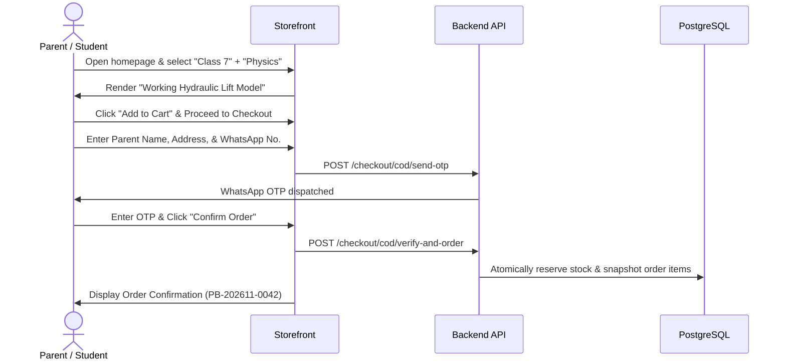

# ProjectBee – Quality Assurance & Testing Plan
## Comprehensive Test Strategy, Automation Suites & Acceptance Scenarios

**Version:** 1.0  
**Status:** Canonical testing specification for implementation  
**Product:** ProjectBee — *School Projects Made Easy!*  
**Test Stack:** Vitest (Unit/Integration), Playwright (E2E), pgTAP (Supabase RLS), k6 (Concurrency & Load)  

---

## 1. Testing Strategy & Test Pyramid

```
            / \
           /   \        [ End-to-End Tests ] (Playwright)
          / E2E \       - Full Customer COD Checkout Flow
         /-------\      - Admin Fulfillment & Shipment Advance
        / Integr. \     - Verified Review Lifecycle Flow
       /   Tests   \    [ Integration & API Tests ] (Vitest / Supertest)
      /-------------\   - REST Endpoints, Supabase RLS Policies (pgTAP)
     /     Unit      \  - WhatsApp OTP Lifecycle, Stock Concurrency
    /      Tests      \ [ Unit Tests ] (Vitest)
   /-------------------\- Taxonomy Filters, Paise Pricing, Validation Schemas
```

| Layer | Target Coverage | Scope | Primary Tools |
| :--- | :--- | :--- | :--- |
| **Unit** | > 85% | Pure business logic, pricing math, tax calculations, input validation schemas, search query sanitization. | Vitest |
| **Database & RLS** | 100% of RLS Policies | Row Level Security policies across public/anon, customer, admin, and super admin roles. | pgTAP / Supabase Local Test Harness |
| **Integration** | > 80% | API endpoints, atomic database transactions, WhatsApp OTP hashing, inventory reservations. | Vitest + Supertest + Local Postgres |
| **E2E Automation**| Critical User Journeys | Customer browsing to COD order placement; Admin fulfillment to AWB generation; Verified review submission. | Playwright |
| **Load & Concurrency**| Key Bottlenecks | Simultaneous checkout race condition on last unit; search burst during exhibition season. | k6 |

---

## 2. Unit Testing Suites

### 2.1 Pricing & Financial Math (`tests/unit/pricing.test.ts`)
- **UT-PRICE-01:** Assert all money calculations use integer paise (no decimal float errors).
- **UT-PRICE-02:** Validate discount computation: `sellingPricePaise = mrpPaise * (1 - discountPercent / 100)`.
- **UT-PRICE-03:** Validate coupon application: flat coupon deduction vs percentage coupon deduction.
- **UT-PRICE-04:** Free shipping threshold check (e.g. Orders >= ₹999 get 0 shipping fee; otherwise ₹70 flat).

### 2.2 Input Validation Schemas (`tests/unit/validation.test.ts`)
- **UT-VAL-01:** Parent mobile and WhatsApp number must be valid 10-digit Indian numbers (`^[6-9]\d{9}$`).
- **UT-VAL-02:** Pincode validation: exactly 6 numerical digits (`^\d{6}$`).
- **UT-VAL-03:** Product review text: minimum 20 characters, maximum 2,000 characters; rating integer 1–5.
- **UT-VAL-04:** Quantity limit per cart item: between 1 and 10 units.

### 2.3 Search & Taxonomy Helpers (`tests/unit/catalog.test.ts`)
- **UT-CAT-01:** Map grade class (1–12) to correct academic group (`early_learners`, `primary`, `middle_school`, `secondary`, `senior_secondary`).
- **UT-CAT-02:** Sanitize search input to prevent SQL/FTS syntax error on special characters (`&`, `|`, `!`, `*`).

---

## 3. Database & Row Level Security (RLS) Tests (`pgTAP`)

Location: `supabase/tests/rls_policies.sql`

```sql
BEGIN;
SELECT plan(8);

-- Test 1: Anonymous users can read published products
SET ROLE anon;
SELECT ok(
  (SELECT count(*) FROM products WHERE status = 'published') >= 0,
  'Anon can view published products'
);

-- Test 2: Anonymous users CANNOT read draft products
SELECT is_empty(
  'SELECT id FROM products WHERE status = "draft"',
  'Anon cannot view draft products'
);

-- Test 3: Customers can only select their own orders
SET ROLE authenticated;
SET request.jwt.claims TO '{"sub": "cust-uuid-1"}';
SELECT is(
  (SELECT count(*) FROM orders WHERE customer_id != 'cust-uuid-1'),
  0::bigint,
  'Customer cannot view another customer orders'
);

-- Test 4: Unauthenticated cannot read audit logs
SET ROLE anon;
SELECT throws_ok(
  'SELECT * FROM audit_logs',
  'permission denied for table audit_logs',
  'Anon cannot query audit_logs'
);

SELECT * FROM finish();
ROLLBACK;
```

---

## 4. Integration Test Suites (`tests/integration/`)

### 4.1 WhatsApp COD Verification Lifecycle (`checkout.test.ts`)
- **IT-CHK-01:** Requesting COD OTP generates a 6-digit random code and stores a salted SHA-256 hash in `cod_verifications`. Plaintext OTP is never written.
- **IT-CHK-02:** Entering the wrong OTP increments `attempt_count`. Exceeding 5 attempts locks the verification.
- **IT-CHK-03:** Entering the correct OTP updates status to `verified` and creates the confirmed order atomically.

### 4.2 Stock Reservation Concurrency Test (`inventory.test.ts`)
- **IT-INV-01 (Race Condition Prevention):**
  - Setup: Product A has `stock_on_hand = 1, stock_reserved = 0`.
  - Action: Fire 10 concurrent requests to `reserve_order_stock` for 1 unit.
  - Assertion: Exactly 1 request succeeds; 9 requests return `409 Conflict / Insufficient stock`. `stock_on_hand` remains 1, `stock_reserved` becomes 1. Zero overselling.

### 4.3 Verified-Purchase Review Qualification (`reviews.test.ts`)
- **IT-REV-01:** Customer with a `delivered` order can submit a review.
- **IT-REV-02:** Customer with a `processing` or `shipped` order receives `403 Forbidden` when attempting to submit.
- **IT-REV-03:** Customer attempting to review the same product twice on the same order receives `409 Conflict`.
- **IT-REV-04:** Review submission triggers the PostgreSQL trigger `update_product_rating_cache()`, recalculating `products.rating_avg` and `products.rating_count`.

---

## 5. End-to-End (E2E) Test Scenarios (Playwright)

### Journey 1: Customer COD Order Placement


**Automated Assertions:**
- Cart subtotal matches catalog price.
- Parent name is displayed on confirmation page.
- Stock on hand is decremented in database.
- Order is visible in customer's "My Orders" tab.

---

### Journey 2: Admin Order Processing & Shipment Generation
1. Admin logs into unified dashboard via Email OTP.
2. Navigates to **Orders** -> selects new `confirmed` order `PB-202611-0042`.
3. Clicks **Advance Status** -> transitions to `processing`, then `packed`.
4. Enters package dimensions (25x15x20 cm, 450g) and clicks **Generate Shipment**.
5. Verifies Shiprocket AWB code is generated and downloadable shipping label PDF is displayed.
6. Order status automatically advances to `shipped`.
7. Checks `audit_logs` table to confirm status transition and actor ID are recorded.

---

### Journey 3: Order Delivery & Verified Review Submission
1. Admin advances order status to `delivered` (simulating courier COD cash collection).
2. Customer visits customer portal -> opens "My Orders".
3. Product card now reveals the enabled **Write a Review** button.
4. Customer submits 5-star rating, review title, and praise text.
5. Review is saved; customer visits public product detail page.
6. Asserts review appears under customer feedback with **Verified Purchase** badge, and overall rating average reflects the new score.

---

## 6. Performance & Load Scenarios (k6)

| Scenario | Target Metric | Tool |
| :--- | :--- | :--- |
| **Catalog Browsing & Search** | 500 Virtual Users (VU), < 300ms p95 response time. | k6 |
| **Product Detail Page Load** | Cache hit < 100ms; Database query < 50ms. | k6 |
| **Checkout Burst (Science Fair Rush)**| 50 concurrent checkouts/sec with zero deadlock or double-booking. | k6 |

---

## 7. QA Sign-Off Gate Criteria

Prior to production release, the following criteria must be satisfied:
- [ ] 100% pass rate on all Playwright E2E customer and admin flows.
- [ ] 0 high or critical vulnerabilities in `npm audit` and Snyk security scans.
- [ ] 100% of PostgreSQL tables tested with pgTAP for RLS policy enforcement.
- [ ] Concurrency testing confirms zero stock overselling under parallel order stress.
- [ ] Visual regression testing verifies mobile responsiveness on Android/iOS screen widths (360px, 390px, 768px, 1280px).

